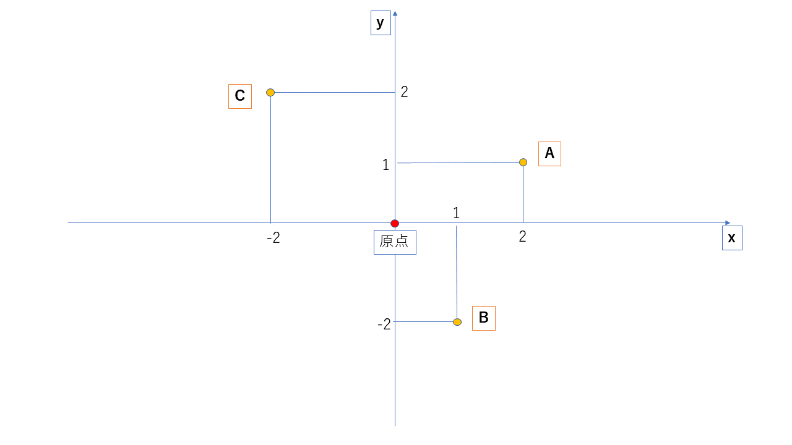
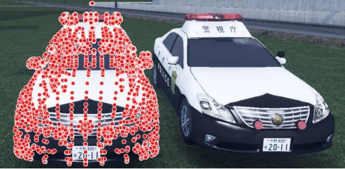
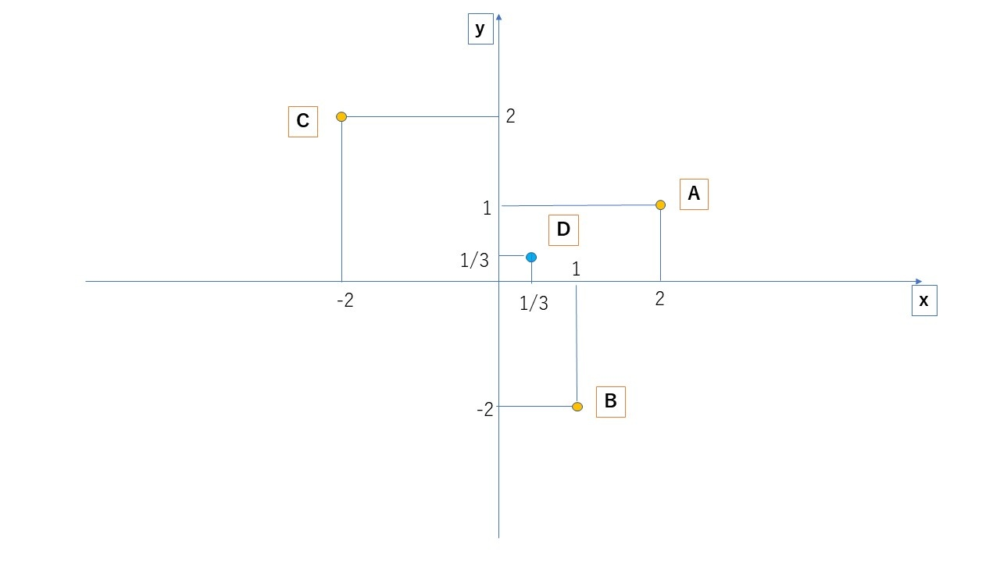
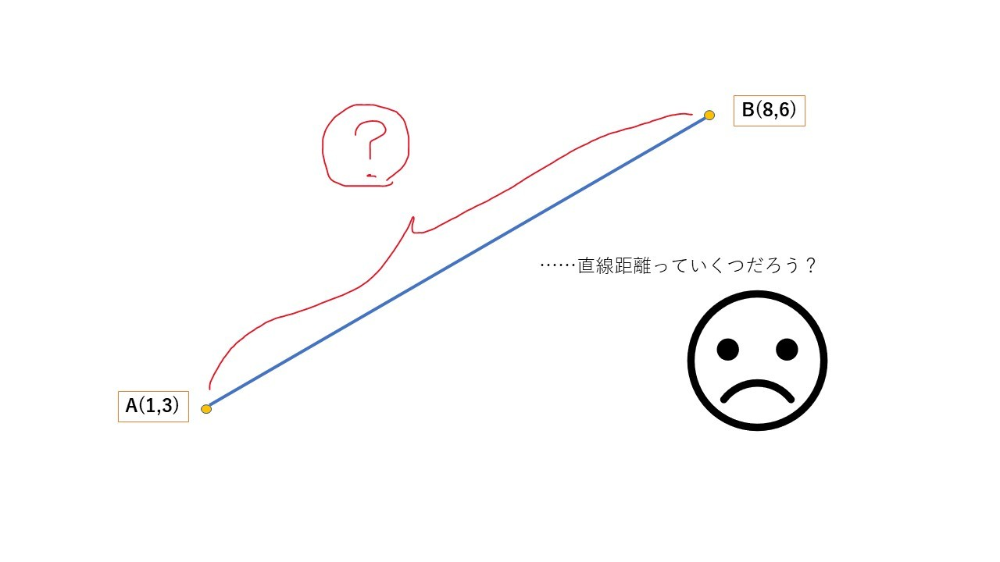
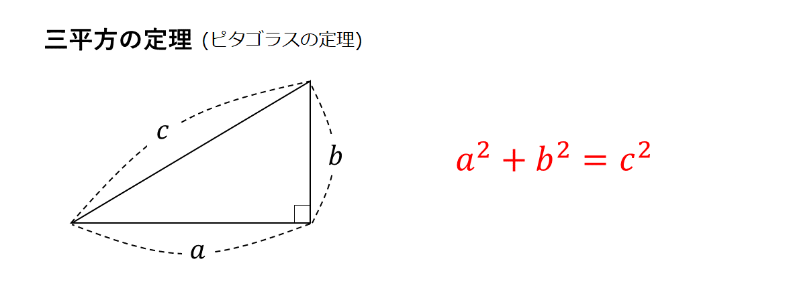
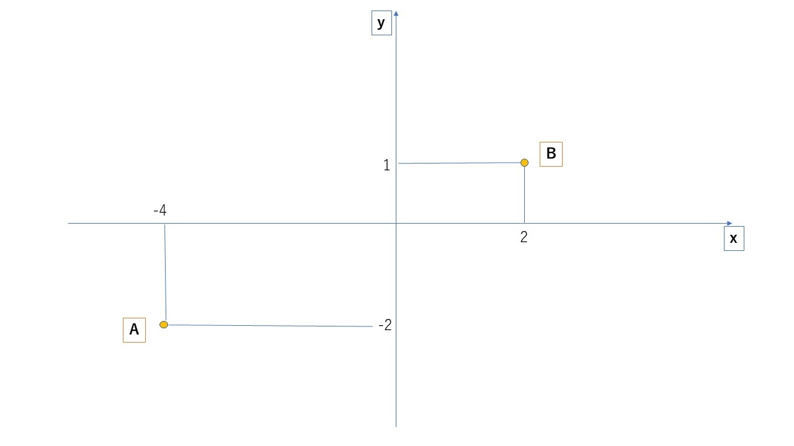
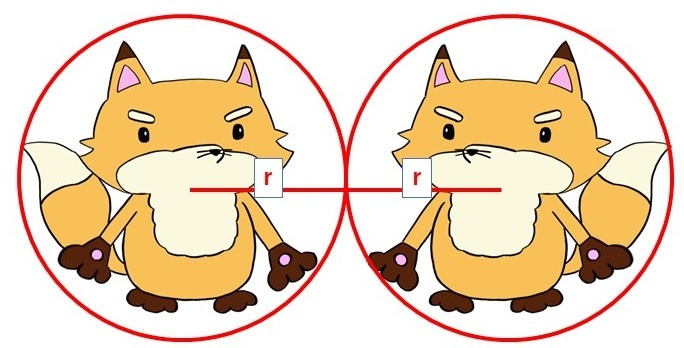

## 概要
点と座標の関係や2点間の距離などについて学びます。物体の運動などを考える際には必ず必要になるので、ゲーム制作においては$\textcolor{red}{プログラマどころかプランナーでも必須}$です。『誰でも作れる』と謳っている汎用ゲームエンジンでもここが分かっていない人は想定していないので、絶対に理解してください。

## 点の座標
点の位置を示す値である。具体的には(1,2)のような物を言い、ある点を基準にそこからどれだけ離れているかを示している。その際の基準となる点を$\textcolor{red}{原点}$などと呼ぶ。

上記において、点の座標を(x座標,y座標)とすると、

$$
A(2,1),　B(1,-2),　C(-2,2)
$$
と表せる。
座標を示す値の数字部分を成分と言い、
上記の場合で言えば(◯,)の部分をx成分、(,◯)の部分をy成分と呼ぶ。
## 中点
複数の点が存在する際に、その中心を知ることは重要である。ゲームにおいて、物体を表現するにはその物体を形成する頂点同士を繋いで表現するが、その際にどこがその物体の中心かが分からなければ描くことが出来ない。一般的なゲームおいては、必ず計算するどころか1秒間に50回以上(最新のゲームだと100回以上)求めている事になる。

### 2点間の中点
2点間の中点ということは、ある点とある点の真ん中の点ということである。であるので、A点とB点の中点をCすると、A点とB点のそれぞれの成分を足して2で割ったものが中点である。

$$
A(2,1)とB(1,-2)の中点　=C(\frac{2+1}{2},\frac{1-2}{2})　=C(\frac{3}{2},-\frac{1}{2})
$$

### 3点間の中点
3点間の中点も考え方は同じで、3点のそれぞれの成分を足して3で割ったものである。

$$
A(2,1)とB(1,-2)とC(-2,2)の中点　= D(\frac{2+1-2}{3},\frac{1-2+2}{3}) =　D(\frac{1}{3},\frac{1}{3})
$$

### n点間の中点
ゲームでは頂点は無数に存在するので、n点間(任意の数の点間)の中点を求める必要がある。
n点間であっても考え方は基本的に同じであり、全ての点の座標を足してnで割れば良い。
下記は例として、4点間の中点を出している。

$$
A(2,1)とB(1,-2)とC(-2,2)とD(-4,-2)の中点\\
= E(\frac{2+1-2-4}{4},\frac{2+1-2-4}{4})
= E(-\frac{3}{4},-\frac{1}{4})
$$

## 点と点の距離
物体の運動を考える際に２点間の距離はたびたび必要になるが、逆を言えば２点間の距離さえ分かればそこを基礎として非常に多くの物理運動を再現できるようになる。物体の運動を考える上では九九のような内容であり、常識として脊髄反射で分かるようになって欲しい。

### ピタゴラスの定理(三平方の定理)
おそらく『三平方の定理』という名前で習ったと思うが、一般的には『ピタゴラスの定理』と呼ばれる事が多いのでそのように記述する。

簡単に言ってしまうと上記であり、
これは、三角形の角度の一つが90度のとき

$$
(斜辺:角90度の向かいの辺の長さ)^2 = (残りの辺A)^2 + (残りの辺B)^2
$$
が成り立つ。
つまり$\textcolor{red}{『直角三角形の2辺が分かれば、残りの1辺を求められる』}$という定理になる。

### 2点間の距離
ピタゴラスの定理を用いることによって、2点間の距離を求める事が出来る。
#### 2点間には直角三角形が存在する
下図のように、2点間には必ず直角三角形が存在する。

ここで、
辺aの長さは2点の$\textcolor{red}{x成分の引き算の絶対値}$
辺bの長さは2点の$\textcolor{red}{y成分の引き算の絶対値}$
で求められるので、

$$
a = \textcolor{red}{|(点Aのx成分) - (点Bのx成分)|}\\
= |1 - 8|=|-7|=7\\
b = \textcolor{red}{|(点Aのy成分) - (点Bのy成分)|}\\
= |3 - 6|=|-3|=3
$$
ピタゴラスの定理により、

$$
c^2 = a^2 + b^2  \\
c^2 = 7^2 + 3^2\\
c^2 = 49 + 9 = 58\\
c = \sqrt{58}
$$
となり、2点間の距離が求まる。

#### 2点間の距離の公式
まとめると、2点間の距離は以下で求まる。
2点間の距離をL,　2点をA(Ax,Ay) B(Bx,By)とすると、

$$
L = \bf{\sqrt{(Ax-Bx)^2+(Ay-By)^2}}
$$

## 2点間の移動
決められた時間をかけて2点間の移動をする運動を考える。
### 相対位置
2点間の移動を考える際には、相対位置という考え方が重要になる。
相対位置とは$\textcolor{red}{『自分から見て相手がどの位置にいるか』}$である。

上記で言えば、

$$
・点Aから見て点Bは　x方向に6,　y方向に3　の位置\\
・点Bから見て点Aは　x方向に-6,　y方向に-3　の位置
$$
となる。x方向、y方向ごとに

$$
(目標の座標)　-　(基準点の座標)
$$

で求まる。

相対位置はある点からある点への移動を考える際に必ず必要なるので、抑えておいて欲しい。

### A点からB点への移動
A点からB点へ任意の時間で動く運動を考える。n秒での移動を考える際は以下の手順で行う。

・A点から見たB点のx方向の相対位置とy方向の相対位置を出す。
・それぞれをnで割ることで、1秒間あたりの移動方向を出す。

となる。
例として、A(1,4),B(-4,6)でありAB間を2秒で移動する運動を考えると、

$$
\\
x方向の相対位置　= (-4-1) = -5\\
y方向の相対位置　= (6-4) = 2\\
$$
であるので、

$$
1秒毎に、\\
x方向に-5/2 ,　y方向に1　移動する運動である。
$$

という形で求める。

## 円の当たり判定
ピタゴラスの定理(三平方の定理)を利用することで、当たり判定としては最も基礎となる$\textcolor{red}{『円の当たり判定』}$を作ることができる。

### 物体の中心から円を作成
当たり判定を作りたい物体の中心点を決め、そこから円を作成。

作成した円と円が接触したとき、当たったと分かれば良い。

つまり、上記の状態の時が当たっているので

$$
\textcolor{red}{『中心から中心までの距離』 ≦ 2r}
$$
となっていれば２つの物体は当たっていると言える。
一般化すれば、

$$
\textcolor{red}{『中心から中心までの距離』 ≦ r+R}
$$
### 問1:円の当たり判定の具体例1
物体A：半径2 中心(1,2),　物体B：半径3 中心(4,3)とする。
問1.物体ABは当たってるか？
問2.もし当たっていたらどれだけ離れれば当たらなくなるか？
#### 問1
ピタゴラスの定理より、

$$
(中心から中心までの距離)^2= (4-1)^2+(3-2)^2=9+1=10\\
(中心から中心までの距離) = \sqrt{10}
$$
これが、『半径＋半径以下』ならば当たっているので

$$
\sqrt{10}≦5  \Leftrightarrow \sqrt{10}≦\sqrt{25}
$$
ABは当たっている。
#### 問2
ABがどれだけ離れたかをdとすると

$$
『中心から中心までの距離』+ d > 『半径の合計』
$$
になれば良いので、

$$
\sqrt{10}+ d > 5\\
d > 5-\sqrt{10}
$$
よって、$5-\sqrt{10}$より離れれば良い。

### 問2:円の当たり判定の一般化
物体A：半径r 中心(a,b),　物体B：半径R 中心(c,d)とする。
ピタゴラスの定理より、

$$
『中心から中心までの距離』 ≦ r+R
$$
が成り立ち、

$$
『中心から中心までの距離』 = \sqrt{(c-a)^2 + (d-a)^2}
$$
となるので、以下が成り立つ。

$$
\textcolor{red}{(c-a)^2 + (d-a)^2 ≦ (r+R)^2}
$$
これが衝突条件であり、
プログラム上ではもっぱらこの計算を毎フレーム行って衝突を確認する。

# 定着プリント

# 演習問題
https://github.com/MahiroCreative/GameMath/blob/main/2.%E7%82%B9%E3%81%A8%E5%BA%A7%E6%A8%99/%E6%BC%94%E7%BF%92%E5%95%8F%E9%A1%8C_2_%E7%82%B9%E3%81%A8%E5%BA%A7%E6%A8%99.pdf