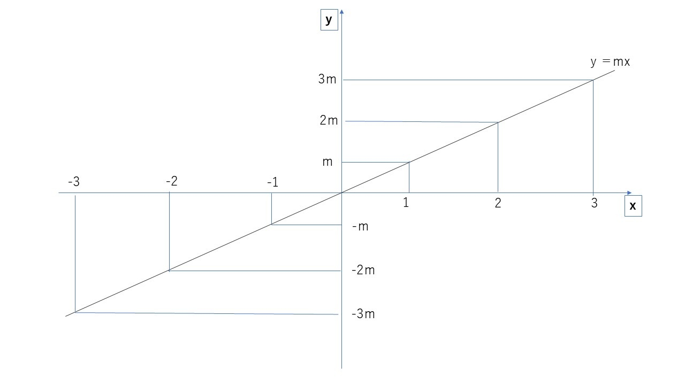
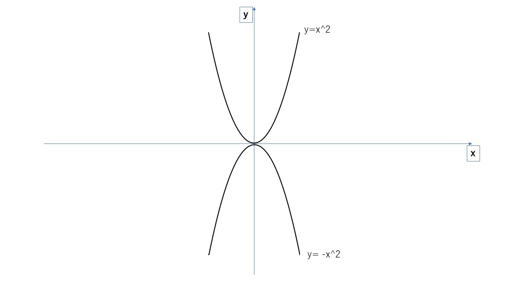
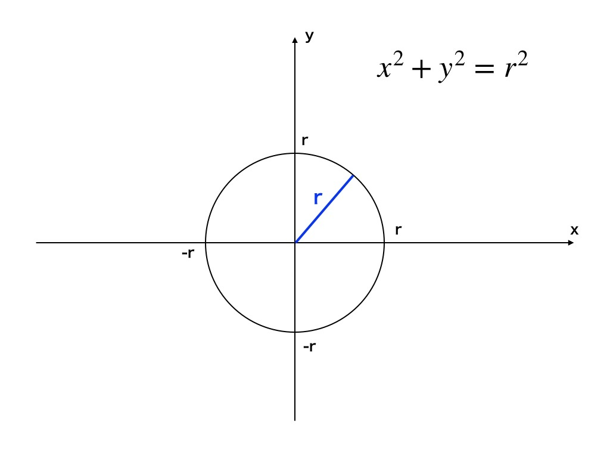

## 概要
方程式とは$\textcolor{red}{『何らかの数値の変化を表したもの』}$です。
数学のみで学ぶと何のために必要なのか分かりにくいですが、ゲームにおいては物体の運動を表すために使用します。
ここではさまざまな方程式の中から、必須のものだけ紹介します。
## 直線の方程式

$y=mx$というような形で表記し、図示としては上記のようになる。
一般化すると、以下になる。

$$
y=mx+b　(m:傾き,b：切片)
$$

直線の方程式は、一定の速度で動く運動(等速運動)などで使用する。

$$
y= 5x+3:　x=2なら、y=13　,x=3なら、y=18\\
y= -2x+1:　x=2なら、y=-3　,x=3なら、y=-5\\
y= 7x-5:　x=2なら、y=9　,x=3なら、y=16\\
$$

## 放物線の方程式

$y=x^2,　y=-x^2$というような形で表記し、図示としては上記のようになる。
一般化すると、以下になる。

$$
y=\pm(x-a)^2+b　(a:xの初期値,　b:yの初期値)
$$

放物線の方程式はその名の通り放物運動で使用する。放物運動とは物を投げた時の運動である。

$$
y= (x-2)^2+3:　x=2なら、y=3　,x=1なら、y=4\\
y= -(x+2)^2+4:　x=2なら、y=-12　,x=1なら、y=-5\\
y= -(x+2)^2-4:　x=2なら、y=-20　,x=3なら、y=-29\\
$$

## 円の方程式

$x^2+y^2=r^2$というような形で表記し、図示としては上記のようになる(rは半径)。
一般化すると、以下になる。

$$
中心(a,b), 半径r\\
(x-a)^2+(y-b)^2 = r^2
$$

円の方程式は円運動でも使用するが、円を用いた当たり判定などでも活用する。

$$
中心(1,2),半径2の円：(x-1)^2+(y-2)^2=2^2\\
中心(-1,2),半径4の円：(x+1)^2+(y-2)^2=4^2\\
中心(-3,-6),半径3の円：(x+1)^2+(y+6)^2=3^2\\
$$
