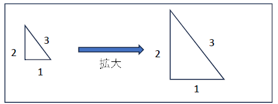
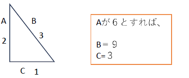
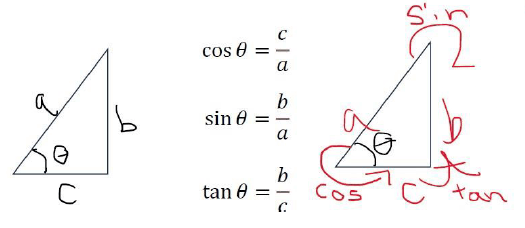

## 概要
ここでは角度を考える上での基礎となる三角比に関して解説します。角度は傾きを表すものであり、それを拡張して回転なども考えることとなります。物体の運動を考える際に『どれほど傾いているか』または『どのように回転しているか』というのは絶対に必要です。このあたりから躓いてしまう学生が増えますが、大事な部分なので必ず理解しましょう。

## ラジアン(弧度法)
三角比に入る前に、まずラジアンという概念について話す。
ラジアン[rad]とは

$$
\bm{ラジアン[rad] = 円の孤の長さ(L) ÷ 円の半径(R)}
$$

の事である。『円の孤の長さ』は『円の半径』と比例して増減するので、同じ角度であればradは円の大きさに関わらず一致する。つまり、radとは角度と同じ物を表すものだと分かり、度数法とは別の角の大きさを表す物がラジアン(弧度法)である。

## 円周率(π - パイ)
円周率は弧度法で表した180度であり、π(パイ)と記述する。

$$
\bm{π[rad] = 180度 = 3.14159265359....}
$$

円周率を用いることで、円の円周や面積を出すことが出来る。

$$
\bm{円周の長さ = 直径 * 3.14...}\\
\bm{円の面積　= 半径 * 半径 * 3.14...}
$$
これをπで表すと、

$$
\bm{円周の長さ = 2πr}\\
\bm{円の面積　= πr^2}
$$
となる。

## 三角比とは
『三角比』の名前から分かるように、**三角形に関する比率を表す**のが**三角比**であるが、三角比を直接考える前に**三角形の比率**に関して考えてみる。

仮に1:2:3の比率の三角形があれば、何倍にしようと比率は同じままである。これは三角形に限らず全ての図形で成り立つことであり、比率が同じということは図形のそれぞれの角が同じということである。
それぞれの角が同じなら比率は同じなので、どこかの辺の長さがわかれば残りの辺の長さも求められる。

このことから、三角形の辺の比率は角度が分かれば分かり、特に**直角三角形**の場合は**90度以外の角が一つでも分かれば比率を求められる**事が分かる。つまり、角度が分かれば『各辺の比率』が分かり、さらに1辺でも求まれば『各辺の長さ』も分かることになる。
これらの計算に使う値こそが**三角比**である。

## 三角比
三角比とは三角形に関する比率を表すと解説したが、特に以下の値が**三角比**と呼ばれる。

それぞれ、sin(サイン),cos(コサイン),tan(タンジェント)と言う。
角度をθとすると、

$$
\bm{sinθ = 角度θの時『斜辺を掛けると高さが出る』値}\\
\bm{cosθ = 角度θの時『斜辺を掛けると底辺が出る』値}\\
\bm{tanθ = 角度θの時『底辺を掛けると高さが出る』値}
$$

という値である。
計算の仕方としては、以下のように覚えると良い。

つまり、三角比とは**任意の辺を掛けると求めたい辺が出る**値のことである。

## 特に覚えておくべき三角比
『以下の３つの直角三角形とその三角比は比率とともに覚えておいて欲しい(上下は同じもの)。
この3種の三角形の比率から求められる数値をベースに、大体の計算が行える。

$$
　sin\frac{π}{6} = \frac{1}{2},
　cos\frac{π}{6} = \frac{\sqrt{3}}{2},
　tan\frac{π}{6} = \frac{1}{\sqrt{3}}\\
　sin\frac{π}{4} = \frac{1}{\sqrt{2}},
　cos\frac{π}{4} = \frac{1}{\sqrt{2}},
　tan\frac{π}{4} = 1\\
　sin\frac{π}{3} = \frac{\sqrt{3}}{2},
　cos\frac{π}{3} = \frac{1}{2},
　tan\frac{π}{3} = \sqrt{3}\\
$$

## 単位円の三角比
三角比を用いて計算を行う際に、基準となる数値があると便利である。そのため、基準として**斜辺を1とした直角三角形**が使われるようになった。これが　**単位円の三角比** である。

単位円ベースで考えることで、常に斜辺は1として考えられる。三角比を考える際には基本的にこの **単位円の三角比**　として考えると良い。
上図で考えるとわかりやすいが、結局のところ

$$
\bm{cosθ = x座標}\\
\bm{sinθ = y座標}
$$

であることが分かるので、斜辺を1にすることで特に整理することなく直角三角形の比率を求めることができ、計算の簡便化が行える。

## 三角比の性質
単位円で三角比を考えることにより、以下が分かる。

$$
tanθ = \frac{y座標}{x座標} = \frac{sinθ}{cosθ}\\
(sinθ)^2 + (cosθ)^2 = (\frac{y座標}{斜辺})^2 + (\frac{x座標}{斜辺})^2
= \frac{(y座標)^2 + (x座標)^2}{(斜辺)^2}\\
$$

単位円なので斜辺は１であり、三平方の定理より$$(y座標)^2 + (x座標)^2=1$$なので、

$$
\frac{(y座標)^2 + (x座標)^2}{(斜辺)^2} = 1
$$

まとめると、

$$
\bm{tanθ = \frac{sinθ}{cosθ}}\\
\bm{(sinθ)^2 + (cosθ)^2 = 1}
$$

この２つの性質だけは最低限覚えておいて欲しい。