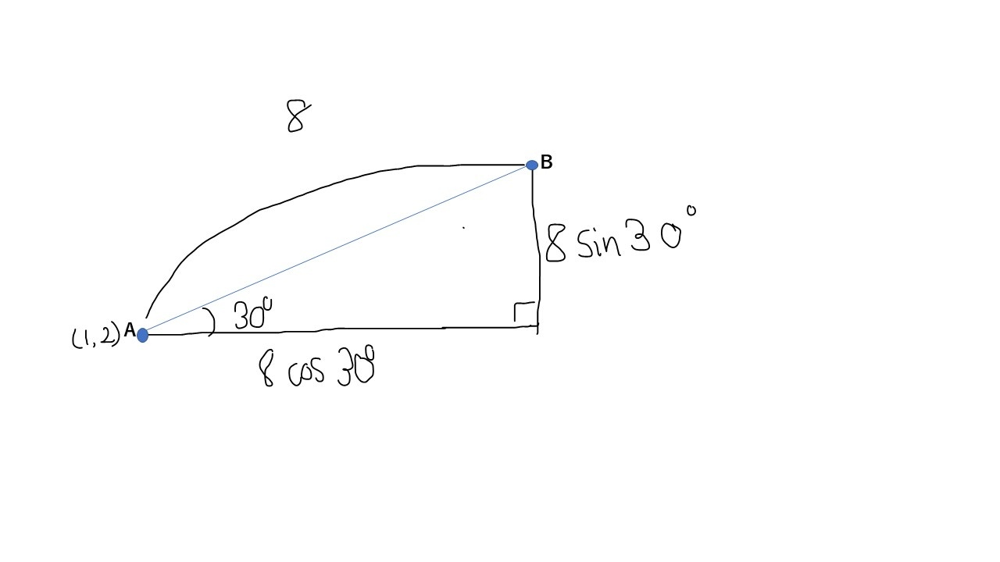
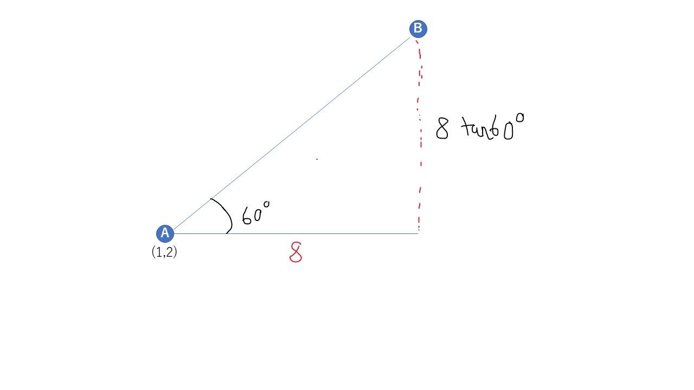

0.ゲーム数学入門（α版）

保存済み
三角比_確認問題
## 確認問題
1.30度,60度,90度,120度,150度,180度 をπを用いて表せ。
2.210度,240度,270度,300度,330度,360度 をπを用いて表せ。
3.45度,135度,225度,315度 をπを用いて表せ。
4.半径が8の円の円周の長さと面積をπを用いて求めよ。
5.斜辺a,底b,高さcのなす角Θの直角三角形が存在する。sinΘを求めよ。
6.斜辺a,底b,高さcのなす角Θの直角三角形が存在する。cosΘを求めよ。
7.斜辺a,底b,高さcのなす角Θの直角三角形が存在する。。tanΘを求めよ。
8.斜辺a,底b,高さcのなす角Θの直角三角形が存在する。三角比とaを用いてbを求めよ。
9.斜辺a,底b,高さcのなす角Θの直角三角形が存在する。三角比とaを用いてcを求めよ。
10.底b,高さcのなす角Θの直角三角形が存在する。三角比とbを用いてcを求めよ。
11.$sin\frac{1}{3}π$,$sin\frac{1}{4}π$,$sin\frac{1}{6}π$を求めよ。
12.$cos\frac{1}{3}π$,$cos\frac{1}{4}π$,$cos\frac{1}{6}π$を求めよ。
13.$tan\frac{1}{3}π$,$tan\frac{1}{4}π$,$tan\frac{1}{6}π$を求めよ。
14.tanΘをcosΘとsinΘで表せ。
15.1をcosΘとsinΘで表せ。
16.物体Aと物体Bの距離が8であり、物体Aの位置が(1,2)である。AとBのなす角は水平線を基準として反時計回りに30度である。物体Bの位置(x,y)を求めよ。
17.物体Aと物体Bの水平距離が8であり、物体Aの位置が(1,2)である。AとBのなす角は水平線を基準として反時計回りに60度である。物体Bの位置(x,y)を求めよ。

## 解答
1.$\frac{1}{6}π$,$\frac{1}{3}π$,$\frac{1}{2}π$,$\frac{2}{3}π$,$\frac{5}{6}π$,$π$
2.$\frac{7}{6}π$,$\frac{4}{3}π$,$\frac{3}{2}π$,$\frac{5}{3}π$,$\frac{11}{6}π$,$2π$
3.$\frac{1}{4}π$,$\frac{3}{4}π$,$\frac{5}{4}π$,$\frac{7}{4}π$
4.$円周=16π$,$面積=64π$
5.sinΘ=$\frac{c}{a}$
6.cosΘ=$\frac{e}{d}$
7.cosΘ=$\frac{i}{h}$
8.b=acosΘ
9.c=asinΘ
10.c=btanΘ
11.$\frac{\sqrt{3}}{2}$,$\frac{1}{\sqrt{2}}$,$\frac{1}{2}$
12.$\frac{1}{2}$,$\frac{1}{\sqrt{2}}$,$\frac{\sqrt{3}}{2}$
13.$\sqrt{3}$,1,$\frac{1}{\sqrt{3}}$
14.$tanΘ=\frac{sinΘ}{cosΘ}$
15.$1=(cosΘ)^2 + (sinΘ)^2$
16.
まずは図示します。

上記の関係になるので、物体Bの位置は
$x=1+8cos30=1+8\frac{\sqrt{3}}{2}=1+4\sqrt{3}$
$y=2+8sin30=2+8\frac{1}{2}=6$
17.
まずは図示します。

目次のプレビュー
確認問題
1.30度,60度,90度,120度,150度,180度 をπを用いて表せ。
2.210度,240度,270度,300度,330度,360度 をπを用いて表せ。
3.45度,135度,225度,315度 をπを用いて表せ。
4.半径が8の円の円周の長さと面積をπを用いて求めよ。
5.斜辺a,底b,高さcのなす角Θの直角三角形が存在する。sinΘを求めよ。
6.斜辺a,底b,高さcのなす角Θの直角三角形が存在する。cosΘを求めよ。
7.斜辺a,底b,高さcのなす角Θの直角三角形が存在する。。tanΘを求めよ。
8.斜辺a,底b,高さcのなす角Θの直角三角形が存在する。三角比とaを用いてbを求めよ。
9.斜辺a,底b,高さcのなす角Θの直角三角形が存在する。三角比とaを用いてcを求めよ。
10.底b,高さcのなす角Θの直角三角形が存在する。三角比とbを用いてcを求めよ。
11.
s
i
n
1
3
π
sin 
3
1
​
 π
,
s
i
n
1
4
π
sin 
4
1
​
 π
,
s
i
n
1
6
π
sin 
6
1
​
 π
を求めよ。
12.
c
o
s
1
3
π
cos 
3
1
​
 π
,
c
o
s
1
4
π
cos 
4
1
​
 π
,
c
o
s
1
6
π
cos 
6
1
​
 π
を求めよ。
13.
t
a
n
1
3
π
tan 
3
1
​
 π
,
t
a
n
1
4
π
tan 
4
1
​
 π
,
t
a
n
1
6
π
tan 
6
1
​
 π
を求めよ。
14.tanΘをcosΘとsinΘで表せ。
15.1をcosΘとsinΘで表せ。
16.物体Aと物体Bの距離が8であり、物体Aの位置が(1,2)である。AとBのなす角は水平線を基準として反時計回りに30度である。物体Bの位置(x,y)を求めよ。
17.物体Aと物体Bの水平距離が8であり、物体Aの位置が(1,2)である。AとBのなす角は水平線を基準として反時計回りに60度である。物体Bの位置(x,y)を求めよ。

解答
1.
1
6
π
6
1
​
 π
,
1
3
π
3
1
​
 π
,
1
2
π
2
1
​
 π
,
2
3
π
3
2
​
 π
,
5
6
π
6
5
​
 π
,
π
π

2.
7
6
π
6
7
​
 π
,
4
3
π
3
4
​
 π
,
3
2
π
2
3
​
 π
,
5
3
π
3
5
​
 π
,
11
6
π
6
11
​
 π
,
2
π
2π

3.
1
4
π
4
1
​
 π
,
3
4
π
4
3
​
 π
,
5
4
π
4
5
​
 π
,
7
4
π
4
7
​
 π

4.
円周
=
16
π
円周=16π
,
面積
=
64
π
面積=64π

5.sinΘ=
c
a
a
c
​
 

6.cosΘ=
e
d
d
e
​
 

7.cosΘ=
i
h
h
i
​
 

8.b=acosΘ
9.c=asinΘ
10.c=btanΘ
11.
3
2
2
3
​
 
​
 
,
1
2
2
​
 
1
​
 
,
1
2
2
1
​
 

12.
1
2
2
1
​
 
,
1
2
2
​
 
1
​
 
,
3
2
2
3
​
 
​
 

13.
3
3
​
 
,1,
1
3
3
​
 
1
​
 

14.
t
a
n
Θ
=
s
i
n
Θ
c
o
s
Θ
tanΘ= 
cosΘ
sinΘ
​
 

15.
1
=
(
c
o
s
Θ
)
2
+
(
s
i
n
Θ
)
2
1=(cosΘ) 
2
 +(sinΘ) 
2
 

16.
まずは図示します。
上記の関係になるので、物体Bの位置は
x
=
1
+
8
c
o
s
30
=
1
+
8
3
2
=
1
+
4
3
x=1+8cos30=1+8 
2
3
​
 
​
 =1+4 
3
​
 

y
=
2
+
8
s
i
n
30
=
2
+
8
1
2
=
6
y=2+8sin30=2+8 
2
1
​
 =6

17.
まずは図示します。
上記の関係になるので、物体Bの位置は
x
=
1
+
8
=
9
x=1+8=9

y
=
2
+
8
t
a
n
60
=
2
+
8
3
y=2+8tan60=2+8 
3
​
 

読み込み中…