## 概要
ベクトルとは物の運動を計算する際には必須の概念になります。当然、物の運動ばかりやるゲームでも必須の知識になります。
高校までの数学では何のために必要なのか分かりにくかったと思いますが、ベクトルを使ってゲームを作れば作るほど『あまりにも便利すぎて手放す事が出来ない』という感想を抱くはずです。
難しいことを考えるためにベクトルを使うのではなく、難しいことを簡単にするためにベクトルを使います。そこを忘れずに、学んでいきましょう。

## ベクトルの基礎
### ベクトルとは？
ベクトルは**方向と量**を持った数値の事です。
私達はこれまでも数値を扱ってきましたが、これまでの数値には**量**しか存在していませんでした。
(これまでの数値の例: ...,-2,-1,0,1,2,...)
ベクトルを用いることで、量だけでなく方向を持った数値(ベクトル)で計算を行えます。

### ベクトルの表し方
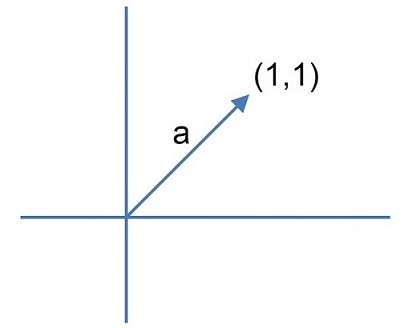
上記のようなaベクトルがあった場合

$$
\vec{a} = (1,1)
$$
というように書きます。
これは**原点からなら点(1,1)に向かうベクトル**という意味です。

### ベクトルの成分
$$
\vec{a} = (1,1)
$$
上記のベクトルの(1,1)を**成分**と言います。

この成分が何を表しているかというと、
**始点が原点なら成分の座標にたどり着く**という意味です。
つまり、そのベクトルがどんな点から始まっていても、成分には原点から始まった際の数値が入ります。

これで分かることは、ベクトルには向きと量のデータはあるが、
**何処が始点なのかのデータは無い**
ということです。

### ベクトルで速度を表せる
『向きと量がある』ということは、ベクトルは速度として扱うのに最適だと分かります。

高校物理ではカリキュラムの関係上、物理式を扱う際にベクトルを用いていませんが、ベクトルを用いることで物理式がより簡単になります。
(※というより、ベクトル無しで物理をするほうが無理があります……)

例えば『X方向に2,Y方向に3』の速度を考えるとき、
ベクトルならば、

$$
\vec{v}=(2,3)
$$
と書けば済みます。

### ベクトルの大きさ
ベクトルは向きと量を持ちますが、成分として表示されるように量はx,yで分かれています。

純粋に向かう方向への量を
**『ベクトルの大きさ』**　というふうに呼びます。

ベクトルの大きさとは矢印の長さです。
原点から成分まで伸ばしたものが矢印なので、ベクトルの大きさは成分の数値を元に**三平方(ピタゴラスの定理)**　で出せます。

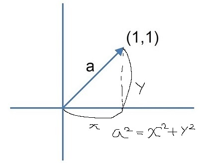

よって、

$$
(ベクトルの大きさ)=\sqrt{x^2 + y^2}
$$

### ベクトルとスカラー
通常の数値を**スカラー**と呼びます。
これはベクトルの対義語に近い意味で、ベクトルとスカラーは明確に区別して扱われます。

$$
スカラー:...,-2,-1,0,1,2,...\\
ベクトル：\vec{a}(1,2),\vec{b}(2,4)\\
(※矢印でベクトルを表しています)
$$

ベクトルの計算はスカラーとは別の概念です。
なので、スカラー計算とは違う計算をします。

### ベクトルの計算
ベクトルの計算は以下のように定義される。
kはスカラーであり、点a(ax,ay),点b(bx,by)とすると、

$$
(点aから点b) = \vec{ab} = (bx - ax,by - ay)\\
(点bから点a) = \vec{ba} = (ax - bx,ay - by)\\
\vec{a} + \vec{b} = (ax + bx,ay + by)\\
\vec{a} - \vec{b} = (ax - bx,ay - by)\\
k\vec{a}=(k * ax,k *ay)\\
\frac{\vec{a}}{k}=(\frac{ax}{k},\frac{ay}{k})\\
$$

具体的に点a(2,1),点b(3,2),k=2で計算すると、

$$
(点aから点b) = \vec{ab} = (3 - 2,2 - 1) = (1,1)\\
(点bから点a) = \vec{ba} = (2 - 3,1 - 2) = (-1,-1)\\
\vec{a} + \vec{b} = (2 + 3,1 + 2) = (5,3)\\
\vec{a} - \vec{b} = (2 - 3,1 - 2) = (-1,-1)\\
k\vec{a}=(2 * 2,2 *1) = (4,2)\\
\frac{\vec{a}}{k}=(\frac{2}{2},\frac{1}{2})=(1,\frac{1}{2})\\
$$

### ベクトル計算の図示

$\vec{ab}$
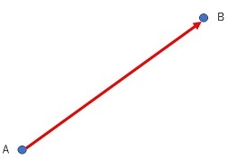
$\vec{ba}$
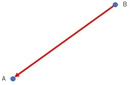
$\vec{a} + \vec{b}$
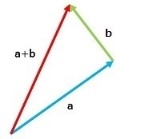
$\vec{a} - \vec{b}$
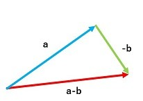
$k\vec{a}$
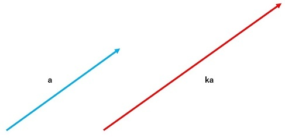
$\frac{\vec{a}}{k}$
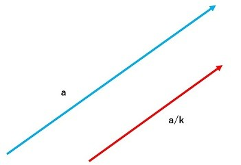

## 内積
ベクトルには**内積**と呼ばれる計算がある。
例えば、$\vec{a}$と$\vec{b}$の内積は

$$
\vec{a} \cdot \vec{b}
$$
という風に書く(読み方は『aドットb』)。
内積はベクトル同士の掛け算と言えるような位置づけである。

### 内積の定義
内積の定義は以下になる。
$\vec{a}(ax,ay),\vec{b}(bx,by)$であり、それらのなす角を$\theta$とすると、

$$
\vec{a} \cdot \vec{b} =
|\vec{a}||\vec{b}|\cos{\theta}=
ax*bx + ay*by
$$
となる。

### 内積の意味
内積とは結局どういう意味かというと、

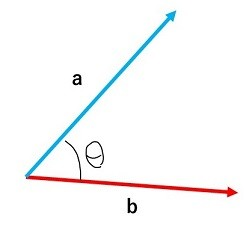

上記のような関係のベクトルがある際に、『それぞれの成分を掛けて足した数』と『それぞれの大きさとcosθを掛けた数』が等しくなる。
という意味である。

もう少し、図形的な意味を考えると、
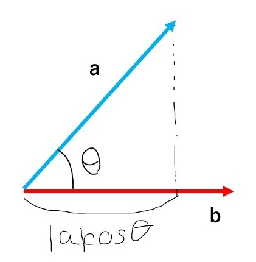

片方のベクトルの大きさから、相手方のベクトルに沿った大きさを作成して、それを相手方のベクトルの大きさに掛けた物、となります。

これを言われてもイマイチ何をしているのかよく分からないと思いますが、
結局のところ、aとbの両方から影響を受ける物体があったとして、

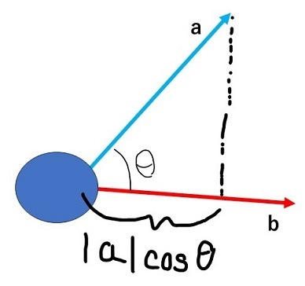

『aベクトルがbベクトル方向に与える影響』と『bベクトルが与える影響』を掛けている。

という風に理解するのが一番分かりやすいかと思います。

### 内積の計算からなす角を求める
具体的に、内積の計算をどのような用途で行うかを示します。
例えば、$\vec{a}(1,0),\vec{b}(1,1)$の内積を計算し、そのなす角を求めるとする。

まずは、成分から内積を求める。

$$
1*1 + 0*1 = 1
$$
$\vec{a} \cdot \vec{b} =|\vec{a}||\vec{b}|\cos{\theta}$であるので、

$$
\cos{\theta} = \frac{\vec{a} \cdot \vec{b}}{|\vec{a}||\vec{b}|}
$$
よって、

$$
\cos{\theta} = \frac{1}{\sqrt{2}}
$$

よって、θ=45°,315
(※なす角は基本的に小さい方を選ぶので、45°を使う)

### 内積による垂直判定
内積の計算により、なす角が求められます。
であるので、内積により計算したベクトル同士が垂直かどうかが確かめられます。

$\cos{\theta}=0$　なら、　$\theta=90°,270°$なので、

いずれにせよ垂直に交わっている事が分かる。
具体的な例を出すと、$\vec{a}(1,0),\vec{b}(0,1)$の内積は、

$$
\vec{a} \cdot \vec{b} = 1*0 + 0*1 =0\\
$$
となり、垂直なベクトルの内積は0となる事が分かる。

## 正規化
あるベクトルの大きさを1にすることを**正規化する**という。
また、あるベクトルの大きさを1にしたものをあるベクトルの**単位ベクトル**と呼ぶ。

### 単位ベクトル
ある方向を向くベクトルで計算を行う際に、大きさは重要ではなく**そちらを向いている**という情報だけが重要な場合がある。
そういう計算を行う際に、大きさを１にしておくことで計算を非常に単純化することが出来ます。

### 単位ベクトルの計算
あるベクトル$\vec{a}(ax,ay)$の単位ベクトルは以下の計算で求められる。
$\vec{a}$の単位ベクトルを$\hat{a}$(aハット)とすると、

$$
\hat{a} = \frac{\vec{a}}{|\vec{a}|}
$$
となり、具体的に$\vec{a}(2,1)$の単位ベクトルを求めると
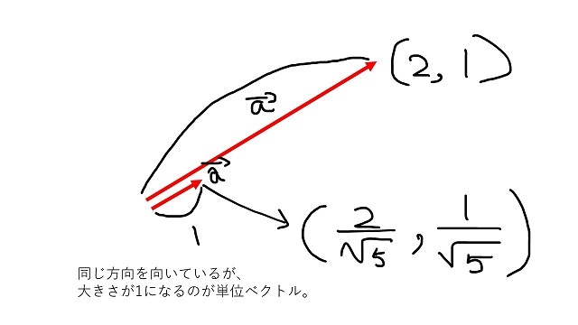

$$
\hat{a} = \frac{(2,1)}{\sqrt{5}}=(\frac{2}{\sqrt{5}},\frac{1}{\sqrt{5}})
$$
となる。

## 外積
ベクトルには内積の他に**外積**と呼ばれる計算があります。
これもベクトル世界においての掛け算のような位置づけのものですが、2次元空間だと役割を持たず3次元空間において役割を持ちます。
なので、本来3次元ベクトルを学ぶ際に学習するのが適当なのですが、ゲームにおいては2次元の当たり判定の際にも用いるので先取りで学んでおくことにします。

### 外積の定義
ある3次元ベクトル$\vec{a}(ax,ay,az),\vec{b}(bx,by,bz)$の外積は

$$
\vec{a}　\times　\vec{b} = (ay*bz – az*by, az*bx – ax*bz, ax*by – ay*bx)\\
$$
上記の計算で求まり、
$\vec{a}$と$\vec{b}$の両方に対して**垂直なベクトル**が求まります。
(※つまり、$\vec{a}\times\vec{b} \perp \vec{a}$ かつ　$\vec{a}\times\vec{b} \perp \vec{b}$)
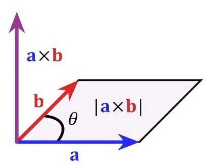

また、外積の大きさは上図に書いてあるとおり、
**$\vec{a},\vec{b}$で描かれる平行四辺形の面積と等しい**という性質が有り、

$$
|\vec{a}\times\vec{b}| = |\vec{a}||\vec{b}|\sin{\theta}
$$

が成り立ちます。
また、**外積そのもので求まった値はベクトルになっている**という事に注意してください。

### 2次元ベクトルから求める外積
2次元では本来外積計算を行うことは出来ませんが、1次元の追加(z軸を追加)を行うことで計算する事が出来ます。具体的には、$\vec{a}(1,2),\vec{b}(2,3)$で外積の計算をするなら、$\vec{a}(1,2,0),\vec{b}(2,3,0)$として外積の計算を行います。

$$
\vec{a}\times\vec{b} = (0,0,1*3 - 2*2) = (0,0,-1)\\
$$

出来上がったベクトルはz方向にしか成分がありませんので、
2次元ベクトルであればどのようなベクトルでも垂直なベクトルが求まる事が分かります。

### 外積の性質
では、外積を求めることで何が分かるのでしょうか。
色々ありますが、**外積計算を行ったベクトルの方向の関係が分かる**、というのがゲーム数学においては最大のメリットです。

具体的な例は複雑ですので、当たり判定の章で解説します。
ここでは**ベクトルの方向の関係が分かる**とだけ、覚えておいて下さい。

