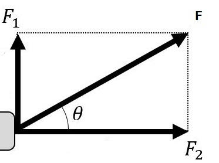

## 概要
ゲームにおけるプログラミングは『何らかの仮想空間の再現』と言っても過言ではありません。これは3Dのアクションゲームなどに限らず、極端な事を言ってしまえばノベルゲーム(紙芝居みたいなゲーム)のようなものでも『そういう法則の世界』を作っていると言えます。
昨今のゲーム業界は3Dゲームが主流であり、またどんなジャンルのゲームであっても何らかのアクション要素があるのが一般的です。ですので、現実の物理現象に近いものをゲーム空間上でも再現することの重要性は、増すというよりは『知っていて当たり前』というレベルにまで達しています。とはいえ、物理学で学ぶ物理現象の全般を知る必要はありません。大抵の場合は力学のみで事足ります。
ここではゲームに必要な力学の基礎の基礎、かつクリティカルに一番必要な『速度と加速度』の部分を学んでいきます。もちろんこれだけでは十分ではありませんが、これだけでも押さえていれば何をすれば良いのか分からず五里霧中になるということを防げます。
ゲーム作りの足がかりの一つとして、しっかりと抑えていきましょう。

## 工事中
どう書くのか悩んでますので、一旦過去に書いた下記pdfリンクを貼ってお茶濁します。
やりたい内容はpdfと同じです。
https://github.com/MahiroCreative/GameMath/blob/main/%E3%82%B2%E3%83%BC%E3%83%A0%E7%89%A9%E7%90%86%E5%AD%A6%E5%85%A5%E9%96%80.pdf

## 内容まとめ
### 次元(ﾃﾞｨﾒﾝｼｮﾝ)

・**距離(x:メートル):x[m]**　：　メールと単位での距離[m]。
・**時間(秒)(time:seconds):t[s]**　：　秒単位での時間[s]。
・**質量(mass:キログラム):m[kg]**　：　kg単位での質量[kg]。
・**速度(velocity):v[m/s]**　：　進んだ距離[m]をかかった時間[s]で割る。
・**加速度:a[m/s/s]**　：　上昇した速度[m/s]をかかった時間[s]で割る。
・**重力加速度:g[m/s/s]**　：　物体が落下するときの加速度。常に一定(およそ9.8[m/s])。
・**力F[N]**　:　国際単位系での力の単位がN(ニュートン)。力は質量のある物体に加速度がかか
ることで生まれる(もしくは力は質量のある物体に加速度を生む)。[N]=[kg*m/s]。

### 水平方向の運動(等速度運動)
初期位置:$x_0[m]$

$$
x = x_0 + v_0t
$$

### 水平方向の運動(等加速度運動)
初期位置:$x_0[m]$,初速度:$v_0[m/s]$

$$
x = x_0 + \frac{1}{2}at^2 + v_0t
$$

### 落体の運動
初期位置(高さ):$y_0[m]$,垂直方向の初速度:$v_0[m/s]$

$$
y = y_0 + \frac{1}{2}gt^2 + v_0t
$$

### 放物線の運動
x初期位置:$x_0[m]$,y初期位置:$y_0[m]$
水平方向の初速度:$v_{x0}[m/s]$,垂直方向の初速度:$v_{y0}[m/s]$

$$
x = x_0 + \frac{1}{2}at^2 + v_{x0}t\\
y = y_0 + \frac{1}{2}gt^2 + v_{y0}t
$$

### 力
力は加速度から生まれ、加速度は力から生まれる。

$$
F[N] = m[kg] * a[m/s] = ma[kg*m/s]
$$
上記の式の意味は、m[kg]であり加速度a[m/s]で動いている物体はF[N]の力を持つということである。
つまり、m[kg]の物体にF[N]の力を加え続けると$\frac{F}{m}[m/s]$で加速する。

### 速度と加速度と力の分解
速度と加速度と力は方向を持つ量です。つまりベクトルです。
なので分解ができます。

$$
F_1 = F*sinθ\\
F_2 = F*cosθ
$$

上記は力での例ですが、速度と加速度も同様に分解できます。

### 力を用いて考える放物線運動
質量:m[kg],重力加速度g[m/s/s]
初期位置:P($x_0$,$y_0$)[m],力:F[N],力の角度:θ[rad]
初速度:V[m/s],速度の角度:θ[rad]
初期加速度は無いとする。

分解すると、

$$
F_x = Fcosθ\\
F_y = Fsinθ\\
V_x = Vcosθ\\
V_y = Vsinθ
$$
よって、

$$
a_x=\frac{Fcosθ}{m}\\
a_y=g +\frac{Fsinθ}{m}\\
(※垂直方向には重力加速度も掛かっている)
$$

以上により、

$$
x = x_0 + \frac{1}{2}(\frac{Fcosθ}{m})t^2 + Vcosθ *t\\
y = y_0 + \frac{1}{2}(g +\frac{Fsinθ}{m})t^2 + Vsinθ *t
$$

### ベクトルを用いた式
上記のように分解により全てスカラー値に直すとややこしい式になってしまう。
そのため、通常は全てベクトルのまま計算する。そうすると以下のようなシンプルな式で計算できる。

求める座標:P
初期座標：$P_0$
加速度:A
初速度:$V_0$

$$
P = P_0 + \frac{1}{2}At^2 + V_0t \\
(※Pはx,y座標)
$$

加速度を用いずに質量m[kg],力F[N]を用いたとすると、

$$
A = \frac{F}{m}
$$
であるので、

$$
P = P_0 + \frac{1}{2}\frac{F}{m}t^2 + V_0t \\
(※Pはx,y座標)
$$

ベクトルについて詳しくはベクトルの章で解説する。