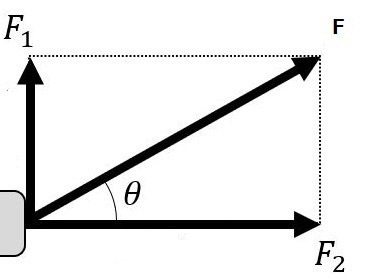
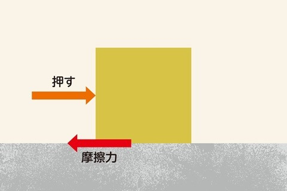
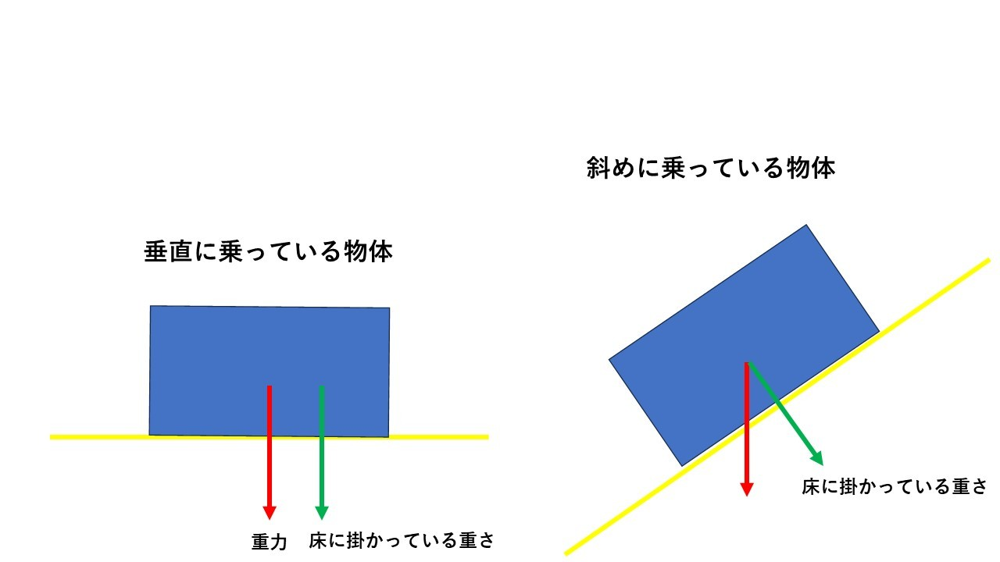
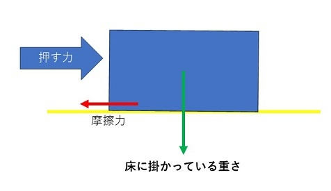
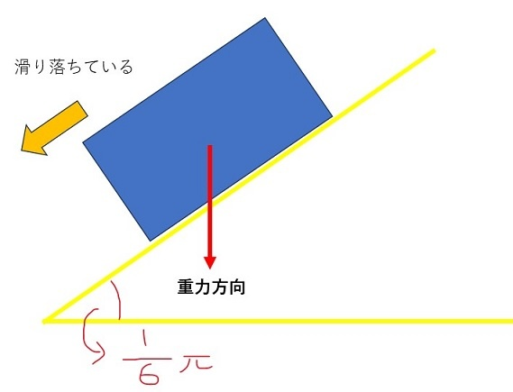
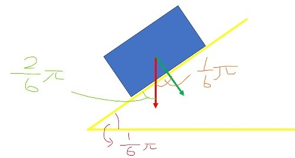
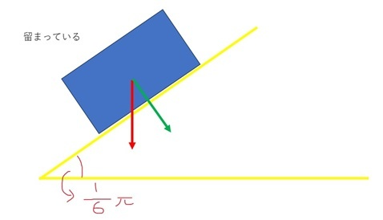

## 概要
ベクトルを学ぶ目的の大部分は物理計算のためと言っても過言ではありません。元々ベクトルは物理学を容易にするために発展してきたという歴史があります。つまり、今日我々が学んでいる物理はベクトルと共に発展しており、ベクトルを使うこと前提の学問となっているということです。
高校までの過程の関係上、別々に学んだ物理とベクトルですがここで合流させておきましょう。

## ベクトルの物理への拡張
物理において速度や加速度は向きと量がある数値でる。つまり、速度や加速度とはベクトルであると言える。また、それらとの計算を容易にするため、物体の現在地である座標もある種のベクトル(複数の成分を一つの値としてもつもの)として計算する。

### 速度と加速度
二次元空間において、1秒間にx方向にa, y方向にb進む物体があるとする。
これはベクトルを用いて表せる。その物体の速度$\vec{v}$は、

$$
\vec{v} = (a,b)[/s]
$$
と表せる。
また、1秒間にx方向にc, y方向にd加速する物体があるとすれば、
その物体の加速度は$\vec{a}$は、

$$
\vec{a} = (c,d)[/s]
$$

これらは、向きと量を持つベクトルである。

### 位置ベクトル
位置ベクトルとは、基準となる点からどれだけ離れているかを示すベクトルである。
(※ここでは特に断りが無い場合は**位置ベクトルの基準点は原点**とする)
位置ベクトルを用いることで、物体の運動をベクトルで計算できます。
簡単な例は以下になります。

$$
\vec{P}(x,y) = \vec{v}(vx,vy) * t  \\
(\vec{P}:物体の位置ベクトル,\vec{v}:速度,t:経過時間)
$$
物理の公式から上記が求まるので、$\vec{v}(2,3)[/s]$とし、経過時間は3[s]とすると、

$$
\vec{P}(x,y) = (2,3)[/s] * 3[/s] = (6,9)
$$

となる。
原点基準の位置ベクトルなので、物体の位置はそのまま(6,9)であると言える。

## ベクトルを用いた運動の式
ここではすでに習った物理の公式をベクトルに置き換えていく。
(※位置ベクトルは簡単化のため$\vec{P}$でなく、Pとして記述する)

### 等速運動
初期位置:$P_0$,速度:$\vec{v}$[/s]

$$
P = P_0 + \vec{v}t
$$

### 等加速度運動
初期位置:$P_0$,初速度:$\vec{v_0}$[/s],加速度:$\vec{a}$[/s/s]

$$
P = P_0 + \vec{v_0}t + \frac{1}{2}\vec{a}t
$$

### 放物線の運動
基本的に等加速度運動と同じだが、物体の持つ加速度に重力加速度が影響を与える。
初期位置:$P_0$,初速度:$\vec{v_0}$[/s],加速度:$\vec{a}$[/s/s],重力加速度:$\vec{g}$[/s/s]

$$
P = P_0 + \vec{v_0}t + \frac{1}{2}(\vec{a}-\vec{g})t
$$

### 力
力も『どの方向にどれだけの力を加える』と考えるのでベクトルです。
例えば、ある質量m[kg]の物体に\vec{F}[N]の力を加えるとすると、

$$
\vec{F} = m\vec{a}
$$

となる。
つまり、力の分解とは力のベクトル成分を出すために行っていたのである。

$$
x成分(F_2):F * cosΘ\\
y成分(F_1):F * sinΘ
$$

### 力を用いて考える放物線運動(ベクトルを用いた式)
初期位置：$P_0$,加速度:$\vec{a}$,初速度:$\vec{v_0}$

$$
P = P_0 + \frac{1}{2}\vec{a}t^2 + \vec{v_0}t \\
$$
加速度を用いずに質量m[kg],力$\vec{F}$[N]を用いたとすると、

$$
\vec{a} = \frac{\vec{F}}{m}
$$
であるので、

$$
P = P_0 + \frac{1}{2}\frac{\vec{F}}{m}t^2 + \vec{v_0}t \\
(※Pはx,y座標)
$$

## 摩擦
ゲームの物理の運動を考える上では上記までである程度大丈夫ですが、さらに追加して摩擦というものも考えていきましょう。
摩擦を考えることで、よりリアルな物体の動きをシュミレートできます。

### 摩擦とは？
物体が何かの上を進んでいるとき、物体の動きに影響を与えるのは重力や物体に加わっている力だけではありません。摩擦と呼ばれるものも存在します。

上記のように、摩擦とは物体が動こうとする方向の反対に発生する力です。
これは物体が何か別の物体に接しているときに発生します。

この摩擦は、物体の質量と摩擦を発生させる表面の性質に応じて変わります。
摩擦係数(どれだけすべにくいか)をuとし、床に掛かっている重さをWとすると摩擦力F'は以下のようになります。

$$
F'=uW
$$

ここで、質量そのものではなく床に掛かっている重さWを用いているには理由があります。

上記のように『床に水平に乗っている物体』と『斜めに乗っている物体』では重力の加わり方が違います。つまり、床に加わっている力が変化するのです。
床に加わっている力に応じて摩擦力が変化するので、
上記の図で言えば、**右側より左側のほうが強い摩擦力が発生する**と言えます。

## 摩擦係数
では、実際に摩擦による影響を考える際に、どの程度の力が加わるのでしょうか。実のところ、動いている物体と動いていない物体で物体に掛かる摩擦力が変わります。それに影響を与えているのが摩擦係数です。
それぞれ動いている時に掛かる摩擦係数を**動摩擦係数**、動いていない時に掛かる摩擦係数を**静止摩擦係数**と呼びます。

### 動摩擦係数
動摩擦係数はその名の通り動いてる物体に掛かる摩擦係数です。
動いている物体に摩擦として一定の力が加わり続けます。

摩擦係数:u,床に掛かっている重さをWとすると、

$$
F'=uW
$$
現在働いている力に加えて、上記の力が加わり続けるということです。

### 静止擦係数
静止擦係数はその名の通り静止している物体に掛かる摩擦係数です。
動摩擦係数が動いている物体を止めようと働く力なら、静止摩擦係数は止まっている物体が動き出さないように抵抗する力の事です。

動かないようにする力なので、物体に掛かっている力に応じて増減します。
(※でないと勝手に動き出すことになってしまいます)
ですので、
最大静止摩擦係数:u',床に掛かっている重さ:Wとすると、

$$
F'\leqq u'W
$$
となります。

つまり、物体を動かそうという力を相殺する分だけ摩擦力が発生しています。
静止摩擦係数で発生する摩擦力を超えると、動摩擦係数に切り替わります。

### 動摩擦係数と動摩擦係数の関係
最大の静止摩擦係数と動摩擦係数には以下が成り立ちます。

$$
u \leqq u'
$$
つまり、物体を押し留めようとする摩擦力が最大になった時に発生する力より、動いている時に発生している力の方が小さいということです。
(※物を押しているときの方が押し始めより楽なのはこのためです)

### 例題1(動摩擦力)
物体Aは斜面を滑り落ちている。
以下の図のような関係にあるとき、物体Aの加速度を求めよ。
質量:M[kg],重力加速度g[/s/s],動摩擦係数:u

まず、斜面の角度が$\frac{1}{6}π$なので、

直角三角形の性質から、斜面に垂直に掛かる力の角度も$\frac{1}{6}π$
よって、物体にかかる力の合計F'は

$$
F' = Mg\cos{\frac{2}{6}π} - uMgcos{\frac{1}{6}π}=Mg(\frac{1}{2} - \frac{\sqrt{3}}{2}u)
$$
aを物体の加速度とすると力の式から、

$$
F'=Ma　より、\\
F'=Mg(\frac{1}{2} - \frac{\sqrt{3}}{2}u)\\
よって、\\
a = g(\frac{1}{2} - \frac{\sqrt{3}}{2}u)
$$

### 例題2(静止摩擦力)
物体Aは斜面に留まっている。以下の図のような関係にあるとき、
物体Aが動き出すには物体をどの程度の力で押せばよいか求めよ。
質量:M[kg],重力加速度g[/s/s],最大静止擦係数:u'

物体は留まっているので、物体に掛かる力の式は

$$
Mg\sin{\frac{1}{6}π}  \leqq u'Mg\cos{\frac{1}{6}π}\\
(※\cos{(90 - \theta)}=\sin{\theta})
$$

これを、F'の力で押したとき、

$$
u'Mg\cos{\frac{1}{6}π} \leqq Mg\sin{\frac{1}{6}π} + F'\\
$$
上記になるような$F'$を求めれば、物体は動き出すので。

$$
F' \geqq u'Mg\cos{\frac{1}{6}π} - Mg\sin{\frac{1}{6}π}\\
$$

上記の力で押せば、物体は動き出す。