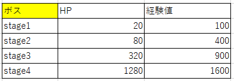

## 概要
数式を数式のまま計算できるというだけでは、数学を学ぶ意味がありません。数学を学ぶ最大の目的は$\textcolor{red}{現実に実際に存在する事象}$を$\textcolor{red}{数式に直して計算する}$ということです。そうすることで現実に起こる出来事を予想したり、ゲームの中で現実の動きを再現したりする事が出来るようになります。
では、現実の出来事を見てそれをそのまま数式に直せるでしょうか？　直せることもありますが、大抵の場合は一旦**言葉(文章)に直す**という過程を必要とします。文章に直すことで、じっくり考えたり比較検討したりしながら数式に直していきます。
ですので、**文章から数式を起こす**という能力がゲーム作りでも必須になっています。

## 基本の問題
では、以下の問を数式にしてみましょう。

### 問
太郎君はお小遣いを1000円持っており、駄菓子屋にお菓子を買いに行きました。100円のチョコレートを2個。50円のガムを3個買いました。太郎君のお小遣いはいくら残っているでしょうか。

上記の文章の結果を求めるだけなら簡単に出来ると思います。しかし、プログラムに実装できるような式に直すにはひと工夫が必要です。具体的な記号や数字を入れる前に、まずは単語で式を作っていきます。例としては以下です。

$$
(太郎君の残りのお小遣い) = (太郎君の元々のお小遣い) \\
- (チョコレートの金額)×(チョコレートの個数)\\
- (ガムの金額)×(ガムの個数)
$$

ここを飛ばしがちですが、ここが大事です。ここをしっかりしていくことで、一体何が分かっていないのか、何が必要なのかが把握できます。しかし、このままでは式がとにかく長くなってしまうので記号に差し替えていきます。

(太郎君の残りのお小遣い):A
(太郎君の元々のお小遣い):B
(チョコレートの金額):C
(チョコレートの個数):D
(ガムの金額):E
(ガムの個数):F

とすると、

$$
A = B - C×D - E×F 
$$
となります。一気に短くなりましたが、意味は分かりにくくなってしまいました。
分かりやすく調整してみます。

$$
\bf{残金 = 元金 - チョコ×チョコ個数 - ガム×ガム個数}
$$
これくらいにしておくのが良いと思います。
どう表記するかは自由ですので、自分なりの分かりやすい形を模索してください。

一応、具体的な数値を入れて計算してみましょう。

$$
残金 = 1000 - 100×2 -50×3 = 650
$$

このように考える手順を記述するのが数式です。
ここまで出来れば後はプログラムに直せば良いだけとなります。

## 割合を含む問題
文字から数式を求める物として頻出なのが割合の計算です。
以下の問を数式にしてみましょう。

### 問
飲み会での会計でX円の支払いがあり、8人で割り勘すると一人当たりY円でした。店内での飲食代として、一人当たり定価で6400円ほどかかり、それとは別にお土産を買っており定価で総額12000円かかっています。店内の飲食代には10パーセントの税が、お土産代には8パーセントの税が掛かるとして、XとYを求めなさい。

上記の問題を考える際に注意すべきことは順序立てて式を考える事です。
一気に考えず、まずは店内飲食代とお土産代を分けて考えます。
店内飲食代をTen,お土産代をOmiとすると、

$$
Ten = 8*6400 *1.1\\
Omi = 12000 * 1.08
$$
XはTenとOmiの合計なので、

$$
X = Ten + Omi = 8*6400 *1.1 + 12000 * 1.08 = 69280
$$
YはXを8で割ったものなので、

$$
Y = X / 8 = 69280 / 8 = 8660
$$
となります。

## グラフ(図)から読み取る問題
グラフを読み取って式に直す問題も必須です。
以下の問いを数式にしましょう。

### 問
下図はボスのHPと経験値の表である。HPと経験値の式を立てよ。

まず、HPの方から考える。
HPは初期値は20であり、stageが上がるごとに4倍されていることが分かる。
stage数をnとすると、以下の式が立てられる。

$$
HP_1 = 20\\
HP_n = 4*HP_{n-1} (n>0)
$$
次に経験値の方を考える。経験値はEXと表記する。
EXはstage1~stage2で300,stage2~stage3で500,stage3~stage4で700増加している。
これを見ると、増加量が200ずつ増加しているのが分かるので、
stage数をnとし、増加量をvolとすると以下の式が立てられる。

$$
EX_0 =　100\\
vol_0 = 0\\
vol_n = 300 + (n-1)*200 (n>0)\\
EX_n = EX_{n-1} + vol_{n-1}(n>0)\\
$$

上記は数列の考えも用いて出した式であるが、
プログラミングを考えるうえでは数列を用いた考え方は重要なので理解してほしい。

## 運動を計算する問題
ゲームプログラミングにおいて運動の計算は必須です。
以下の問を数式にしてみましょう。

## 問
A地点からB地点に向かう運動を考える。田中さんはA地点からB地点に時速15kmで向かっている。佐藤さんはAからBに50m進んだ位置から時速8kmで進んでいる。木村さんは田中さんと佐藤さんから2秒遅れて時速30kmで進む。それぞれの運動の式を立てよ。また、木村さんが田中さんに追いつくのは何秒後か。

それぞれの式を立てると以下になる。
田中の現在地を$X_t$,佐藤の現在地を$X_s$,木村の現在地を$X_k$とする。
tを時間とする。

$$
(X_t,X_s,X_k > 0)\\
田中: X_t = 15t\\
佐藤: X_s = 8t + 0.05\\
木村: X_k = 30(t-\frac{2}{3600})
$$

上記から、木村さんが田中さんに追いつく時間は$X_t=X_k$が成り立つ時なので、

$$
15t = 30(t-\frac{2}{3600})\\
15t = \frac{60}{3600}\\
15t = \frac{1}{60}\\
t=\frac{1}{900}\\
$$

tは時間[/h]なので、3600倍すると秒になる。
$\frac{1}{900} *3600 = 4$
以上により、4秒後である。