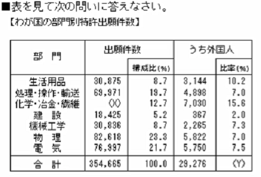

## 確認問題
以下の文章題を数式に直し、問に答えよ。
1.
Pクラスは全体の3/4が60歳以上。Qクラスは全体の3/5が60歳以上である。両クラスとも60未満が10人であるとき、全体の人数はPクラスがQクラスより何人多いか。(2024卒ゲームSPI)
2.
父と母の年齢差は7歳で、父、母の年齢はそれぞれ子の年齢の6倍、5倍である。このとき、子の年齢は何歳か。(2024卒ゲームSPI)
3.
現在Pは10歳であり、6年後にPの年齢はQの年齢の1/2になる。Pの年齢がQの年齢の1/3にあたるのはPが何歳のときか。(2024卒ゲームSPI)
4.
ある観光地を訪れた人のうち、カメラを持っていた人は52人、ビデオを持っていた人は28人であり、カメラを持っていた人のうち1/4人はビデオも持っていた。ビデオを持っていたがカメラを持っていなかった人は何人か。(2024卒ゲームSPI)

5.Xを求めよ。(2024卒ゲームSPI)
6.Yを求めよ。(2024卒ゲームSPI)
7.電車が速度0[km/h]から等加速度Aで加速し、その後、等加速度Aで減速して速度0[km/h]になったという。移動時間は3時間、距離は30kmであった。この電車の最高速度は？(2024卒ゲームSPI)

## 解答
1
$(P60歳以上)=\frac{3}{4}P,　(Q60歳以上)=\frac{3}{5}Q$
$10=\frac{1}{4}P よって、 P=40, 10=\frac{2}{5}Q よって、Q = 25$
よって、PがQより15人多い。
2
$父 - 母=7,　父=6子,　母=5子$
よって、子の年齢は7歳。
3
$16 = \frac{1}{2}Q,　P=16,Q=32$
P=8歳のとき、Q=24歳なので、P=8歳のとき。
4
$(カメラ持ち)=52,　(ビデオ持ち)=28,　(カメラ・ビデオ持ち)=13$
上記が分かるので、
$(カメラだけ持ち)=52-13=39,　(ビデオだけ持ち)=28-13=15$
5
$X=354665*\frac{127}{1000} = 45042(切り捨て)$
6
$Y=\frac{29276}{354665}*100 = 8.2(切り捨て)$
7
まず、等加速度で加速した後に同じ加速度で減速するので、
減速し始める際の移動時間は1.5時間であり、距離は15kmである。
等加速度運動の距離の公式より、
$15 = 0 +\frac{1}{2}at^2$
が成り立つので、
$15 = 0 +\frac{1}{2}a(\frac{3}{2})^2$
$15 = 0 +\frac{9}{4}*\frac{1}{2}a$
$120=9a$
$a=\frac{40}{3}$
等加速度運動の速度の公式より、
$V=V_0 + at$
より、
$V=\frac{40}{3} * \frac{3}{2}$
$V=\frac{120}{6}=20[km/h]$
