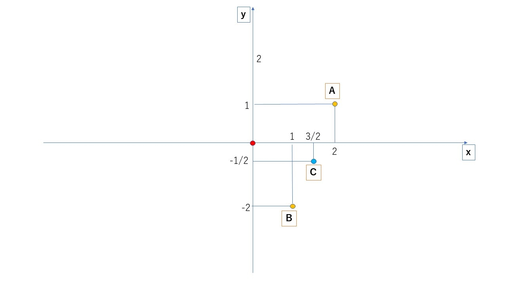
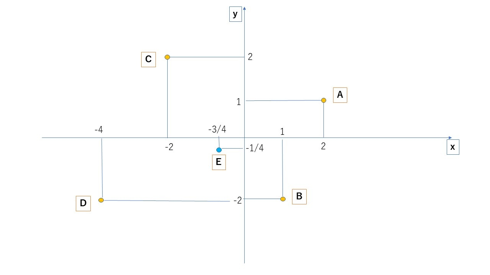
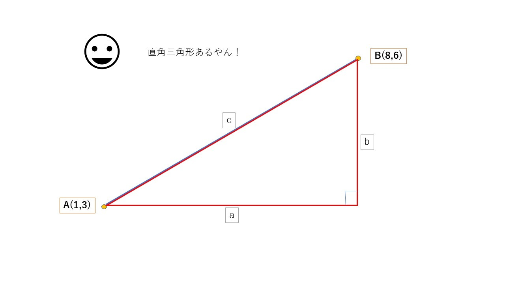
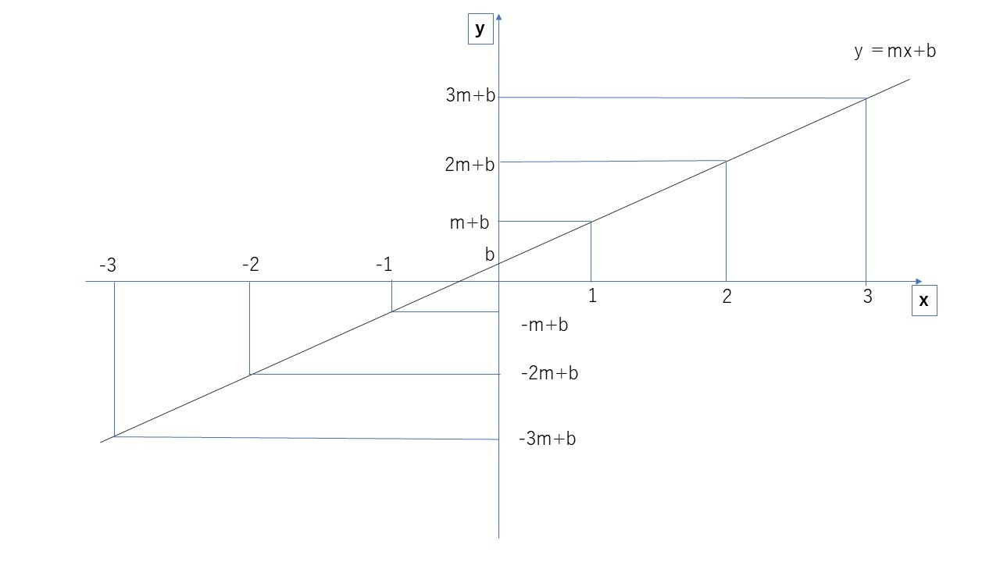
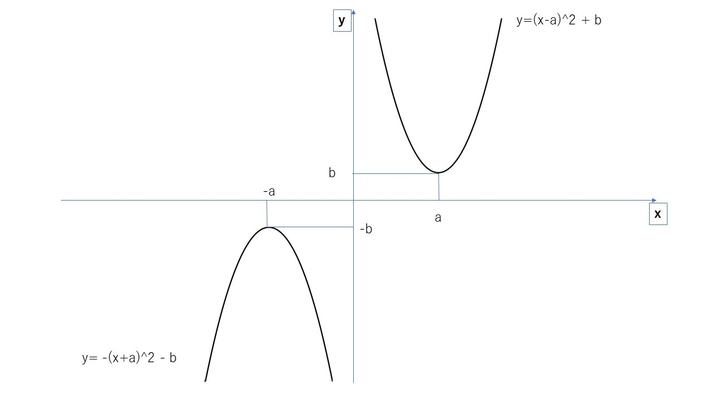
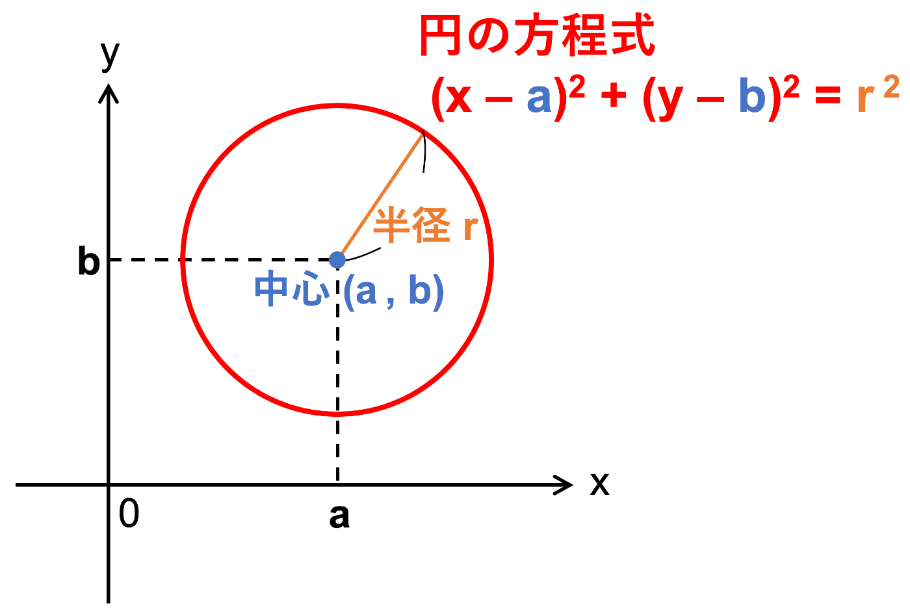
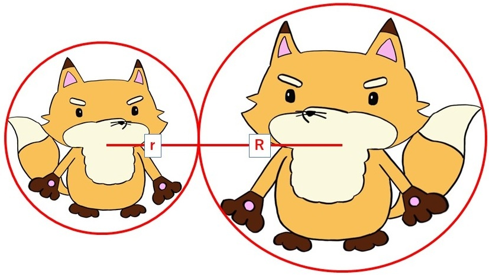
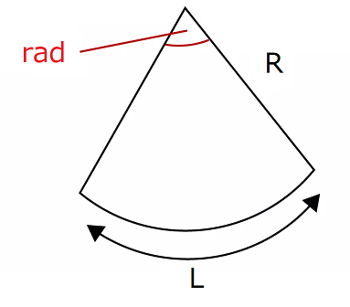
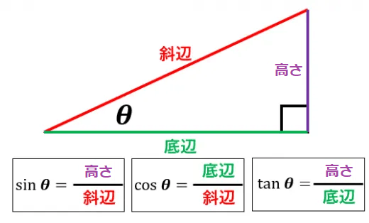
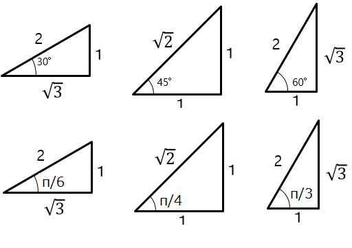

# 全体まとめ
## 基礎計算
### 累乗根の計算
$$
(\sqrt{X})^2 = X\\ 
(\sqrt[a]{X})^a = X\\
 \sqrt[a]{X} = X^\frac{1}{a}\\
X^{-a} = \frac{1}{X^a}\\
X^a * X^b = X^{a+b}\\
(X^a)^b = X^{ab}
$$

## 点と座標
### 中点の座標
A(2,1)とB(1,-2)の中点

$$
C(\frac{2+1}{2},\frac{1-2}{2})　=C(\frac{3}{2},-\frac{1}{2})
$$

### n点間の中点
A(2,1)とB(1,-2)とC(-2,2)とD(-4,-2)の中点

$$
E(\frac{2+1-2-4}{4},\frac{2+1-2-4}{4})
= E(-\frac{3}{4},-\frac{1}{4})
$$

### 2点間の距離の公式
2点間の距離をL,　2点をA(Ax,Ay) B(Bx,By)とすると、

$$
L = \bf{\sqrt{(Ax-Bx)^2+(Ay-By)^2}}
$$

## 方程式
### 直線の方程式

$$
y=mx+b　(m:傾き,b：切片)
$$

### 放物線の方程式

$$
y=\pm(x-a)^2+b　(a:xの初期値,　b:yの初期値)
$$

### 円の方程式

$$
中心(a,b), 半径r\\
(x-a)^2+(y-b)^2 = r^2
$$

### 円の当たり判定

$$
\textcolor{red}{『中心から中心までの距離』 ≦ r+R}
$$

## 三角比
### ラジアン(弧度法)

$$
\bm{ラジアン[rad] = 円の孤の長さ(L) ÷ 円の半径(R)}
$$

### 円周率(π - パイ)

$$
\bm{π[rad] = 180度 = 3.14159265359....}
$$

### 三角比

$$
\bm{sinθ = 角度θの時『斜辺を掛けると高さが出る』値}\\
\bm{cosθ = 角度θの時『斜辺を掛けると底辺が出る』値}\\
\bm{tanθ = 角度θの時『底辺を掛けると高さが出る』値}
$$

### 特に覚えておくべき三角比

$$
　sin\frac{π}{6} = \frac{1}{2},
　cos\frac{π}{6} = \frac{\sqrt{3}}{2},
　tan\frac{π}{6} = \frac{1}{\sqrt{3}}\\
　sin\frac{π}{4} = \frac{1}{\sqrt{2}},
　cos\frac{π}{4} = \frac{1}{\sqrt{2}},
　tan\frac{π}{4} = 1\\
　sin\frac{π}{3} = \frac{\sqrt{3}}{2},
　cos\frac{π}{3} = \frac{1}{2},
　tan\frac{π}{3} = \sqrt{3}\\
$$

### 単位円の三角比

$$
\bm{cosθ = x座標}\\
\bm{sinθ = y座標}
$$

### 三角比の性質

$$
\bm{tanθ = \frac{sinθ}{cosθ}}\\
\bm{(sinθ)^2 + (cosθ)^2 = 1}
$$

## 式の作成
文章中に出てくる単語の関係を1つ1つ数式に落とす必要がある。
### 例
太郎君はお小遣いを1000円持っており、駄菓子屋にお菓子を買いに行きました。100円のチョコレートを2個。50円のガムを3個買いました。太郎君のお小遣いはいくら残っているでしょうか。

$$
(太郎君の残りのお小遣い) = (太郎君の元々のお小遣い) \\
- (チョコレートの金額)×(チョコレートの個数)\\
- (ガムの金額)×(ガムの個数)
$$

# まとめ
ここまでの内容はゲーム数学を学びだすうえでの必須知識と言えます。
『勉強したので知ってる』ではなく、『当然の常識』となるまで何度でも繰り返して欲しいです。
さぁ、ゲーム数学はここからです！　楽しさを見いだせるのもここからです！！
頑張っていきましょう！！！