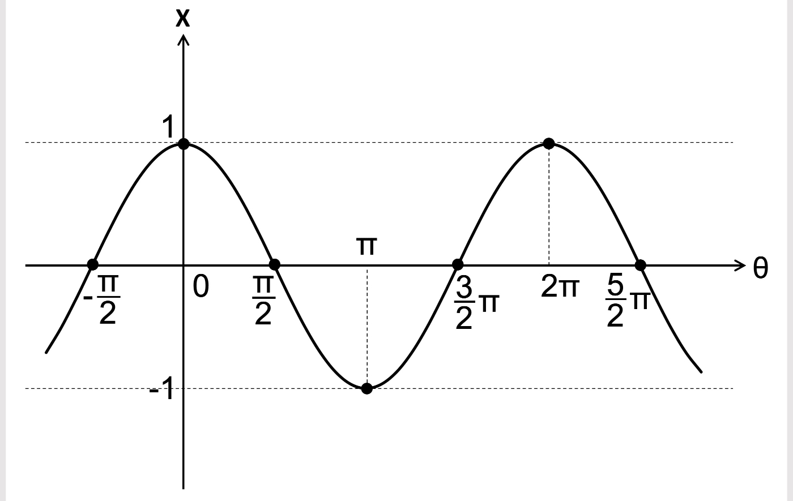
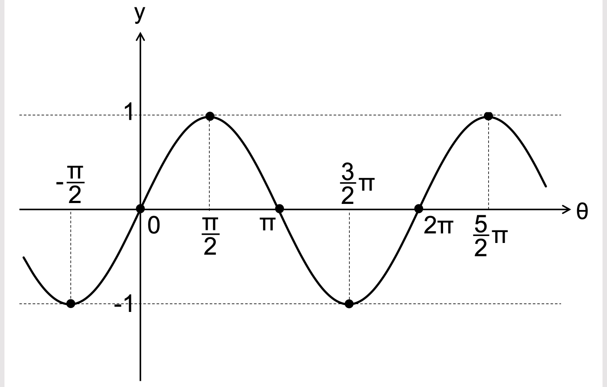
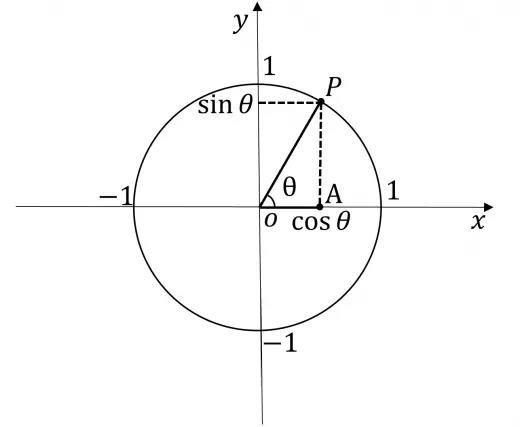
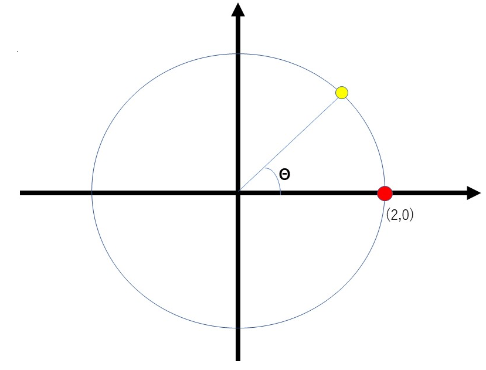
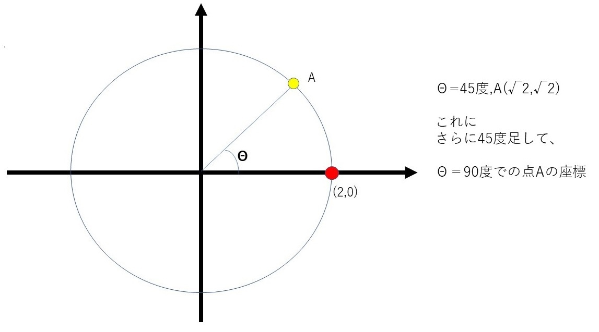
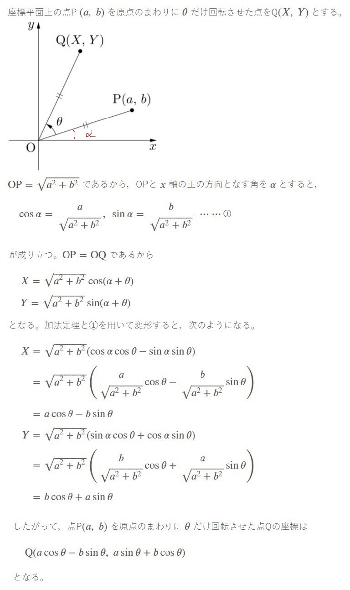
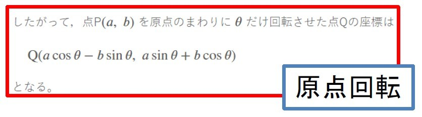
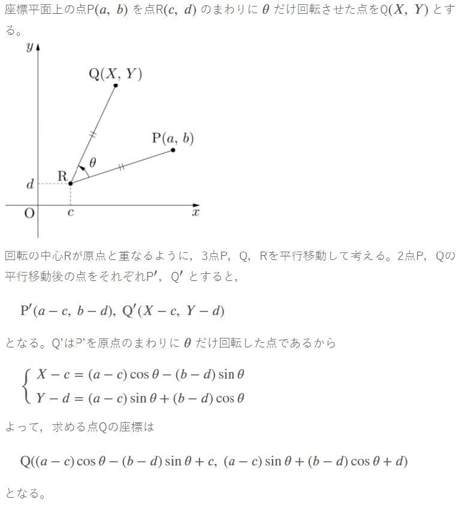
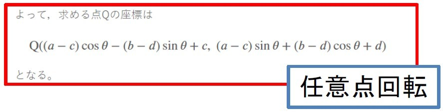

## 概要
三角比の性質もとに三角比の様々な法則を式にまとめたのが三角関数です。
三角関数の代表例として以下の3つがあります。

**・余弦定理**
**・正弦定理**
**・加法定理**

本来なら全部覚えたほうが良いですが、ゲームでは加法定理さえ覚えていればどうにかなります。なので、ここでは加法定理を主に学習します(ただし、加法定理の証明には余弦定理と正弦定理が必要ですので証明が気になる方は別サイトで学んで下さい)。

## 三角比のグラフ
三角比とは以下のような内容のものでした。

上記で導き出す値をグラフで考えてみます。

**・x=cosΘのグラフ**

**・x=sinΘのグラフ**

どちらも-1~1を動いている事になります。
これはどういう事かというと、y軸をsinθ,x軸をcosθ　とすると、
下の単位円のようなグラフを描けます。

**円を描く点のx座標　：　cosΘ**
**円を描く点のy座標　：　sinΘ**

となるので、xとyの値は-1~1間を増減していく事になります。

## 三角関数
### 三角比は回転を表す
三角比のグラフと単位円の三角比を見て分かることとして、三角比とは三角形の比率だけでなく回転も表している事が分かります。
例えば、ある点A(2,0)が原点中心に45度回転した座標を考えると、

$$
x = 2cos45° = 2*\frac{1}{\sqrt{2}} = \sqrt{2}\\
y = 2sin45° = 2*\frac{1}{\sqrt{2}} = \sqrt{2}
$$

となるので、単純な座標の回転なら三角比で表せる事が分かります。

### 加法定理
三角比には以下の性質が有り、これを**加法定理**と呼びます。

$$
\sin(\alpha+\beta)=\sin{\alpha} \cos{\beta} + \cos{\alpha} \sin{\beta}\\
\sin(\alpha-\beta)=\sin{\alpha} \cos{\beta} - \cos{\alpha} \sin{\beta}\\
\cos(\alpha+\beta)=\cos{\alpha} \cos{\beta} - \sin{\alpha} \sin{\beta}\\
\cos(\alpha-\beta)=\cos{\alpha} \cos{\beta} + \sin{\alpha} \sin{\beta}\\
\tan(\alpha+\beta)= \frac{\tan{\alpha}+\tan{\beta}}{1-\tan{\alpha}\tan{\beta}}\\
\tan(\alpha-\beta)= \frac{\tan{\alpha}-\tan{\beta}}{1+\tan{\alpha}\tan{\beta}}
$$
上記をまとめると

$$
\sin(\alpha \pm \beta)=\sin{\alpha} \cos{\beta} \pm \cos{\alpha} \sin{\beta}\\
\cos(\alpha \pm \beta)=\cos{\alpha} \cos{\beta} \mp \sin{\alpha} \sin{\beta}\\
\tan(\alpha \pm \beta)= \frac{\tan{\alpha} \pm \tan{\beta}}
{1 \mp \tan{\alpha}\tan{\beta}}\\
$$

覚えたほうがもちろん良いですが、覚えれないなら覚えなくても良いです。
これがあることを知っていて、必要な時に調べて使って下さい。

### 加法定理は何に使えるのか？
加法定理の公式そのものは覚えていなくても良いです。
しかし、加法定理で何が出来るかは把握しておく必要があります。

公式を見れば分かるのですが、
加法定理は **三角比の角度を後から加減する** 事に使えます。

具体的にどういうことかと言えば、
**既に回転している物体をさらに回転させる**のに使えます。

以下を考えてみましょう。

既に45度回転している状態で、さらに45度回転させます。
加法定理の公式を使うと、

$$
x座標=2 * \cos(45° + 45°)= 2*(\cos{45°} \cos{45°} - \sin{45°} \sin{45°})\\
y座標=2 * \sin(45° + 45°)= 2*(\sin{45°} \cos{45°} + \cos{45°} \sin{45°})\\
$$

となるので、計算すると

$$
x座標= 2*(\frac{1}{2} - \frac{1}{2}) = 0\\
y座標= 2*(\frac{1}{2} + \frac{1}{2}) = 2\\
$$

となり、これは90°回転させた座標と一致するので、
加法定理を用いると**既に回転している物体をさらに回転させる**のに使えると分かります。

## 三角関数による回転
では、三角関数による回転を一般化して公式に直していきましょう。
それぞれ一度だけは証明して公式が求められる事は理解したほうが良いですが、覚える必要はありません。必要な際に調べてそのつど理解できれば大丈夫です。

### 原点を軸にした回転

証明は以上であり、公式は以下となる。

### 任意の点を軸にした回転

証明は以上であり、公式は以下となる。

