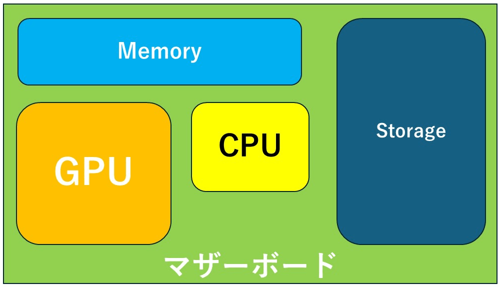
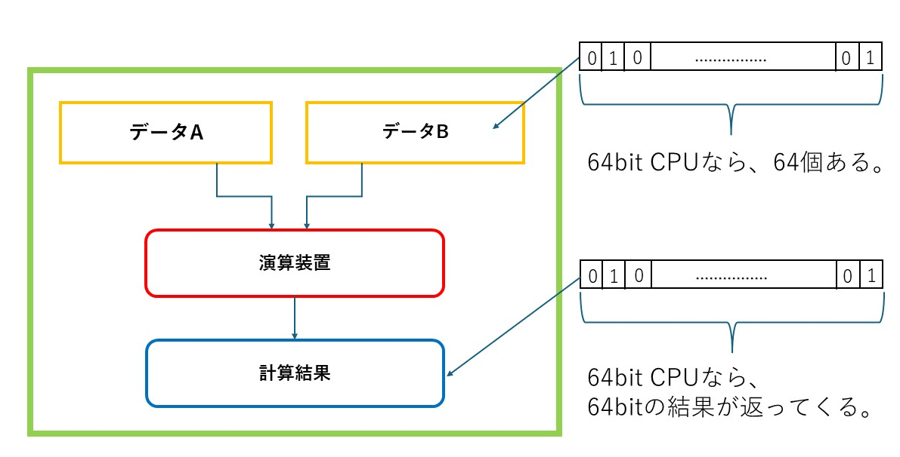
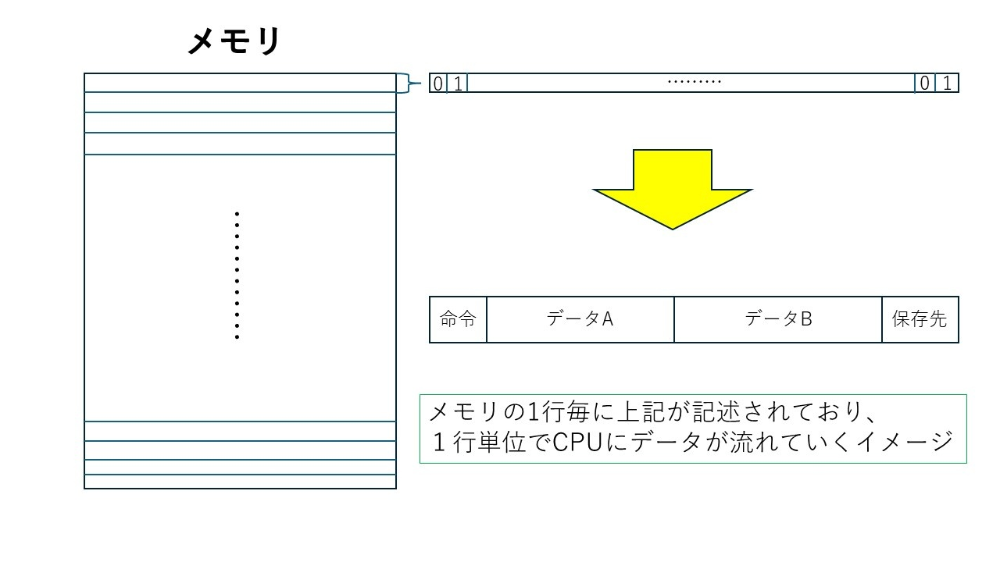
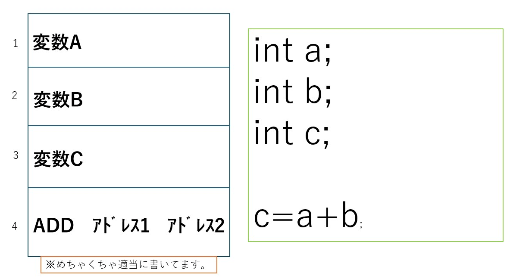
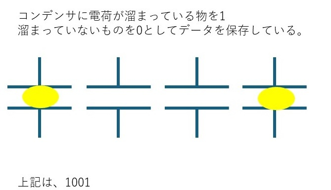

## 概要
本格的にゲーム数学に入っていく前に、まずはコンピュータ上での計算の仕組みについて理解しましょう。人間の計算の考え方と、コンピュータの計算の考え方は大きく違います。効率の良い計算を行うためには、人間の計算の考え方をコンピュータの考え方に置き直して命令を考える必要があります。一般プログラマならあまり深く考えなくてもいいですが、ゲームプログラマは処理速度の限界に常にチャレンジしているような業種です。ある程度はコンピュータの計算の仕組みを知っておく必要があります。

## コンピュータの内部構造
昨今、色々と違う仕組みも出てまいりましたが、基本的には以下のような構造になっています。

上記はものすごく単純化してますが、大体こんな構造だと思っておけばいいです。
(※詳しく知りたい人は画像検索でもしてください)

『マザーボード』と呼ばれるそれぞれの装置を繋げる基盤の上に、『CPU』『GPU』『Memory』『Storage』が載っていてそれぞれの役割を果たすことでコンピュータを形成しています。

それぞれの機能を詳しく見ていくと、

**CPU：通常計算をする(画像計算は遅い)**
**GPU：画像計算をする(通常計算は遅い)**
**Memory:計算をする際の一次保存場所(読み書きが早いが、電源切ると消える)**
**Storage：データの長期保存場所(読み書きが遅いが、電源切っても消えない)**

というような構造になっています。
『CPU・GPU』『Memory』『Storage』の速度差ですが、物や状況にもよりますが、非常に大雑把に表すと以下になります。

**【データアクセス時間】**
**CPU：1**
**Memory:80**
**Storage:100,000**

とんでもない速度差があると分かります。長期保存できるかどうかでこれ程の差が出るのです。
『PCが遅いな』と感じたら、まずはStorage(HDDとかSSDとか)を買い替えるのが無難です。

## CPUの計算の仕組み
コンピュータの中でも計算を行っている部分、人間でいうと脳を司る部分がCPUです。
CPUの計算の仕組みをめちゃくちゃざっくり説明すると以下のような計算の仕組みになっています(※正確さより理解しやすさを優先しています)。

メモリから『データA』と『データB』を取り出して、演算装置で計算し、計算結果を
再びメモリに返す。という動きだとざっくり考えて良いです。

## メモリのデータ保存の仕組み
プログラムを実行するためのデータを一時的に保管しておく場所がメモリです。
流れとしてはストレージからプログラムに必要なデータをメモリに取り出し、メモリのデータを使ってCPUで計算させながらプログラムを実行するというイメージです(※実際はプログラムの実行中にストレージにアクセスすることもありますが、ここで話を簡単にするためにそういうことにしておきます)。
メモリのデータ保存の仕組みをざっくりと表すと以下になります。

上記のような形で、保存されています。
つまり、

$$
\bf命令部:データ部1:データ部2:保存先\\
$$
のような形でメモリの1行が構成されており、それぞれ2進数で書かれています。
簡単なデータの具体例を考えてみると、

$$
【ものすごい適当な例】\\
(※命令部の0001はAddを表すとします)\\
\bf{0001:0001:0001:0001}

$$
上記の様な命令は、『足し算せよ』『1』と『1』を結果はアドレス『0001』に保存。
という意味になり、

$$
\bf(保存先アドレス)=1+1
$$
というプログラムと同じ意味になります。
また、メモリに保存されているデータと命令を並べて考えると、大体以下のような構造になります。

上記のような形(実際は2進数で書かれている)でメモリ上に命令が並んでおり、上から実行していく形でプログラムの処理は行われます。

ここまで見れば分かると思いますが、コンピュータの計算は内部的には2進数で行われています。我々が通常計算を行っているのは10進数なので、人間の脳みそとは大分違うやり方で計算を行っている事になります。
昨今ではコンピュータも発達し、人間がわざわざ2進数を直接入力する事は減りました。しかし、内部は2進数で計算されいる事を知らないと最適化は図れませんし、思わぬバグを生みます。
ですので、2進数での計算、特にコンピュータに関わる計算であるbit演算を学ぶ必要があります。

## 2進数
bit演算を学んでいく前にまずは2進数を学びます。
2進数とは数字をすべて0と1だけで表現する数の事です。ちなみに、我々が普段使っている数字は10進数と言いますが、0 1 2 3 4 5 6 7 8 9 の合計10個で表現するので10進数と呼びます。
2進数は、0 1　の2つで表すので2進数です。

では、具体的に2進数でどう数を表すのかをみていきます。

$$
10進数 : 2進数\\
0 : 0\\
1 : 1\\
2 : 10\\
3 : 11\\
4 : 100\\
5 : 101\\
6 : 110\\
7 : 111\\
8 : 1000\\
$$
上記で大体分かったかと思います。
つまり、1つの桁では1までしか計算できず、2になったら桁が繰り上がるということです。

### 10進数から2進数
10進数から2進数への変換方法について解説します。
単純に2で割れば良いのですが、試しにやってみましょう。

$$
・15を2進数に変換\\
15 / 2 = 7 ...1\\
7 / 2 = 3...1\\
3 / 2 = 1...1\\
1 / 2 = 0 ...1\\
$$
となった場合、1111が変換後と言えます。

最初の余りが1なので、1桁目は1。
2番目の余りが1なので、2桁目は1。
3番目の余りが1なので、3桁目は1。
4番目の余りが1なので、4桁目は1。

という風に考えます。理由を考えていくと、

**・全体を2で割った時の余りは最初の桁の数字になる。**

というのは全ての進数で同じです。
2まで数えたら繰り上げが起こるということは、例えば3を2進数にすると、

$3 = 1*2^1 + 1*2^0$

という風に考えられるので、3は11となり。
2で割った際の余りが1桁目になるのは自明です。

**・全体を2で2回割った時の余りは2番目の桁の数字になる**

というのも全ての進数で同じです。
例えば5を2進数にすると、

$5 = 1*2^2 + 0*2^1 + 1*2^0$

となりますので、5は101となります。
ですので、2で2回割った際の余りが2桁目になります。
今回は2で2回割っても余りがないので、0です。

というようにやっていき、最後に割った回数での答えがそれで割り切れる桁数になるので、
最後の答えが一番左の桁数になります。

これは言葉で説明しても大変分かりにくいので、様々な例をノートに書いて確認してください。

### n進数
ここで進数を一般化しておきます。
2進数は2で割っていくことで作れました。n進数はnで割ることで作れます。

【例:8進数】

$$
・30を8進数に変換\\
30 / 8 = 3 ...6\\
3 / 8 = 0...3\\
よって、36
$$

【例:16進数(0~9~A~F)】

$$
・30を16進数に変換\\
30 / 16 = 1 ...14\\
1 / 16 = 0...1\\
よって、1E
$$

特に8進数と16進数はコンピュータの計算でよく使いますので、
上記の変換は出来るようになっておいてください。

## bit演算
コンピュータは2進数で計算を行っているというのは説明した通りです。
ですが、紙面の上での計算と違い、様々なハードウェア的な制約があります。
そこでそのような制約も考慮した計算の方法が考案されました。それがbit演算です。

### bit
そもそもbitとは何でしょうか？
コンピュータが2進数でデータを保持する際、データはコンデンサに電荷が溜まっているか溜まっていないかで0か1かを判定しています。図で示すと以下のような形になります。

このコンデンサ1つで保存できるデータ量を1bitと呼びます。
例えば、4bitならコンデンサ4つで保存できるデータ量を表現できるので、

$$
0: 0000　～　15 : 1111
$$
ということになります。

### データの単位
上記のbitの考え方からデータの単位が生まれています。
ハードウェア設計の関係上、コンデンサは8つセットで設計されますので単位も8bitが基準にされます。なので、1bitを1Byteとして以下のような表記でデータ量は表されます。

$$
1Byte　:　8bit\\
1MB　：　1000Byte\\
1GB　:　1000MB\\
1TB　:　1000GB\\
$$

ちなみに何故1Byteは8bitなのかというと、ちょうどアルファベット1文字を表すデータ量が
8bitだからです。日本語は16bit.2Byteなので、日本語のような文字を2Byte文字というふうに呼びます。

### コンピュータの四則演算
さて、ではコンピュータ上で四則演算をする際に、どのような仕組みで行っているかを考えていきます。
実のところコンピュータは単純な計算しか出来ません。誤解を恐れずに言ってしまえば、足し算しか出来ないと言えます。
しかし、我々はプログラミング上で引き算も出来れば割り算や掛け算もできます。しかし、ハードウェア的にはそのどの計算も足し算しか行っていません。

どのような仕組みで行っているのでしょうか？
動作の基本的な考え方としては、以下になります。

$$
【引き算】\\
A - B = A + (-B)\\
【掛け算】\\
A*B = A + A + A + ...\\
【割り算】\\
A/B = A + (-B)+(-B)+(-B)+ ...\\
$$
つまり、
引き算は『-Bを足す』。
掛け算は『B回Aを足す』。
割り算は『Aから-Bを何回足せるか数える』。
という形で考えられています。

例えば、8に-2を足せば6ですし、8を2回足せば16ですし、8は-2を4回足せるので4となります。

### 2の進数の足し算
さて、2進数の足し算を考えるとき、人間の頭用にいちいち10進数に直してから計算するとかえって遅くなります。コンピュータにも応用が効きません。
そこで、2進数のまま計算する方法を考えます。

$$
11 : 1011\\
9 : 1001\\
$$
上記を考える際に、20にしてから2進数に直すよりそれぞれの桁の値を見て足したらどうなるかを考えるほうが簡単に計算がきます。

$$
11 : 1011\\
9 : 1001\\
20 : 10100\\
$$

互いに1が入る桁は繰り上がり、それ以外は素直に足すと考えるとやりやすいです。
上からではなく、下の桁から繰り上がっていく形で考えましょう。

### 2の補数
2進数の足し算はできるようになりました。コンピュータは足し算しかできないので、これで全ての計算ができるはずです。が、足したら引かれる数、つまり負の数が無ければそれも出来ません。
そこで作られたのが『2の補数』と呼ばれるものです。

【『2の補数』の作り方】
・各bitの0と1を反転させる(bit反転)
・上記に1を足す

$$
【4bitの『2の補数』の例】\\
3:0011\\
-3:1101\\
5:0101\\
-5:1011\\
$$
『2の補数』はこのような形で作れます。
ただし、コンピュータ上のbit演算でしか正常に機能しないことに注意してください。
理由としてはその計算のさせかたにあります。

$$
【4bitの演算】\\
8 : 1000\\
7 : 0111\\
-7 : 1001\\
8 + (-7) : 1000 + 1001\\
(※10001になるが、4bit計算なので最上位bitは格納できず消える)\\
1: 0001
$$
というような計算の流れになるので、『最上位bitは格納できず消える』というような構造を持つコンピュータ上のbit演算でないと機能しない事が分かります。

### シフト演算
『2の補数』を用いることによって、全ての計算を行えるようになりました。
しかし、割り算や掛け算に関しては正攻法でやると随分と手間が掛かる事が分かります。
そこで用いるのがシフト演算です。

例えば、4bitで表現される数値を2倍することを考えましょう。

$$
3 : 0011\\
6 : 0110\\
$$
これをよく見ると、bitを左に一桁ずらしていることが分かります。
これを『**1bit左シフト**』と言います。
では、今度は4倍してみましょう。

$$
3 : 0011\\
12 : 1100\\
$$
今度は2bitシフトしています。
つまり、求めたい値が元の値の$2^n$倍であれば、左シフトを行えば簡単に計算できることが分かります。

次に、4bitで表現される数値を2で割ることを考えましょう。

$$
8 : 1000\\
4 : 0100\\
$$
今度はbitを右に一桁ずらしていることが分かります。
これを『**1bit右シフト**』と言います。
では、今後は4で割ってみましょう。

$$
8 : 1000\\
2 : 0010\\
$$
つまり、求めたい値が元の値の$2^{-n}$倍であれば、右シフトを行えば簡単に計算できることが分かります。

# 確認と演習

## 問題
### 問1
(2)0010 なら、2進数。(n)0010なら、n進数とする。
以下の値を全て10進数にせよ。

・(2)0100
・(2)1010
・(8)1570
・(8)0041
・(16)00AB
・(16)102F

### 問2
2の補数を用いて以下を負の値にせよ。
なお、4bitでの計算とする。

・0001
・1001
・0101
・0111

上記で求めた値に1100足した値を全て求めよ。

### 問3
以下の計算をして、2進数で表記せよ。
尚、bit数は無限とする

・1001 の4倍
・1000 の1/2倍
・1111 の3倍

## 解答
### 問1
(2)0010 なら、2進数。(n)0010なら、n進数とする。
以下の値を全て10進数にせよ。

・(2)0100 = 4
・(2)1010 = 10
・(8)1570 = 512 + 320 + 56 = 888
・(8)0041 = 32 + 1 = 33
・(16)00AB = 160 + 11 = 171 
・(16)102F = 4096 + 32 + 15 = 4143

### 問2
2の補数を用いて以下を負の値にせよ。
なお、4bitでの計算とする。

・0001 = 1111(-1)
・1001 = 0111(-9)
・0101 = 1011(-5)
・0111 = 1001(-7)

上記で求めた値に1100足した値を全て求めよ。

・1111(-1) + 1100(12) = 1011(11)
・0111(-9) + 1100(12) = 0011(3)
・1011(-5) + 1100(12) = 0111(7)
・1001(-7) + 1100(12) = 0101(5)

### 問3
以下の計算をして、2進数で表記せよ。
尚、bit数は無限とする
・1001(9) の4倍 = 100100(100000(32)+100(4)) 
・1000(8) の1/2倍 = 0100(4)
・1111(15) の8倍 = 1111000(1000000(64)+100000(32)+10000(16)+1000(8))